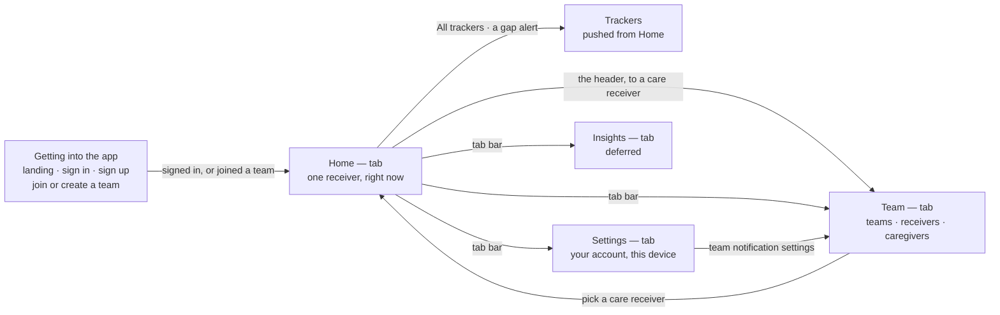

# Product Requirements

## About this document

This document is the authority on what the product is. When it and the built app disagree, the
document is right and the app is what changes: it describes the target state rather than the current
implementation, and much of it is deliberately ahead of what exists. Decisions about scope,
behavior, and vocabulary are settled here first, and anything built is expected to answer to it.

It stays high level on purpose. It covers the problem being solved, the goals, the shared vocabulary
the team uses to talk about the domain, and the experiences a caregiver moves through — never files,
functions, endpoints, or the internals of any client. Those live in the repository, change far
faster than the product does, and would make this document wrong within a week of being written.

What is unresolved is recorded rather than hidden. Each flow ends with the gaps in it, so a path
nobody has thought through is visible instead of being discovered mid-build, and the open questions
at the end hold the decisions still to be made.

## Problem Statement

When someone requires care, multiple caregivers often share responsibility and need to coordinate.
Each caregiver needs a way to log the care they provide and stay informed about what others are
doing, but every care receiver is different. Therefore, caregivers only want to track what's relevant
to that person. Today, caregivers have no easy way to visualize or make sense of the care being given
over time, or to connect it to what's happening in the care receiver's life.

## Goals

- Caregivers have a central place to organize and track the care they give to shared care receivers
- Caregivers gain insight into the care receiver's life through trends and charts
- Caregivers receive reminders about upcoming care and alerts when logged values fall outside their
  expected range
- Caregivers feel confident they're not duplicating effort or missing important care, even when
  multiple people are involved

## Definitions

**Caregiver** — A person who helps care for a care receiver and logs entries about that care. Every
member of a care team is a caregiver; a caregiver can belong to more than one care team.

A caregiver can close their account. Doing so takes away the person — their name, their address,
their way back in — but not the care they recorded: every entry and journal note they wrote keeps its
values, its time, and its place in the timeline, and the name against it becomes **a former
caregiver**. The record belongs to the care receiver and the team rather than to whoever typed it,
and no family should lose six months of readings because the person who took them left. What is
removed is the caregiver; what stays is the care.

**Care receiver** — A person who is being cared for, and about whom entries are logged. Each care
receiver has a time zone, and every wall-clock rule about them is expressed in it: when a schedule
fires, when a scheduled entry is due, when it becomes unrecorded, and where one day ends and the
next begins. Caregivers always see a receiver's times in that zone, whatever zone they are
themselves in, so everyone on a team calls the evening dose by the same name. If a receiver's time
zone changes — they move, or spend the winter somewhere warmer — their routines keep their
wall-clock times and shift with them, because an 8:00am dose is a dose taken after waking up, not a
dose taken at a particular instant.

A care receiver can be **archived** when the team stops caring for them — they moved into a
facility, or they died. Archiving stops the future without touching the past, as pausing does for a
tracker: the receiver leaves Home, the receiver switcher and Quick log, their schedules stop
generating, and nothing about them reminds or alerts anyone. Everything recorded about them stays,
readable by the team from Team but no longer changed, and an admin can restore them, returning
everything as it was. The app offers no way to delete a receiver. A team that has just lost someone
should not be one tap from erasing the record of the last year of that person's care, and a delete
would take every other caregiver's entries and notes with it. Erasing a receiver entirely is
something a family asks support for, which removes everything recorded about them.

**Care team** — A shared space containing one or more care receivers and the caregivers who look
after them. Every care receiver, tracker, and entry belongs to exactly one care team.

A caregiver joins by invitation and may leave at any time; leaving takes away the access and not the
record, so every entry and journal note they wrote stays exactly where it was, under their name. A
team always has at least one admin, and nothing anyone does may leave it without one — the last
admin cannot demote themselves, leave the team, or close their account until someone else has been
promoted. A team with no admin could never invite a caregiver, add a receiver, or make a tracker
again, and no path inside the app leads back out of that.

A care team ends when its last caregiver closes it. Leaving is refused to the last admin, but the
last caregiver on a team is by definition its last admin, and refusing them a way out would leave a
team nobody can join, holding a receiver's whole record with no way to reach it. So the last
caregiver is offered **Close this care team** in place of Leave: the team is archived, nobody can
reach it any longer, and everything recorded in it is kept. As with a receiver, erasing a team
entirely is something support does on request, never a button in the app.

**Admin** — A role held by one or more caregivers on a care team. Admins invite and remove
caregivers, promote other caregivers to admin and demote them again, and manage the team's care
receivers, trackers, care instructions, and coverage. The caregiver who creates a care team is its
first admin. Every caregiver logs entries and can see who else is on the team and what role they
hold; admins additionally manage the team's setup.

**Invitation** — How a caregiver joins a care team. An admin creates an invitation for a particular
email address, then shares it with that person however they already talk to them; the app
does not send email on their behalf.

There are two ways to redeem one, and the common one asks nothing of the invitee. A caregiver who
signs up with the address they were invited at finds the invitation waiting in the app and accepts
it — no code, no link, nothing to carry between two apps. For when that address will not work —
someone uses Apple's Hide My Email, or signs up with a different address than the admin had on hand
— every invitation also carries an **invite code** the admin copies and sends, and the invitee
pastes into the app, so a wrong guess at someone's email is a small annoyance rather than a dead
end. The code is long and random rather than short enough to read aloud, because it is always
copied: nobody should be able to reach a care team by guessing. An admin can copy it again from the
team's pending invitations for as long as it goes unused.

Every invitation joins a team as a caregiver. Nobody becomes an admin by redeeming anything: an
admin is made by an existing admin promoting somebody already on the team, by name — a deliberate
act about a person they can see, rather than a property of a code that may have been passed along.
The first admin of a team is whoever created it.

An invitation is single-use and expires after two weeks, so a code shared once does not stay live.
An admin cannot create one for somebody already on the team, and an invitation redeemed by an
existing member is refused as it is redeemed. The second guard is the one that matters, because the
first can be walked around: two invitations sent in confusion leave one live behind the other, and
an invitee using Hide My Email may accept with an address their invitation never named, so no check
made against an email address can be relied on. Membership is the thing worth asking about, and it
is asked at the only moment that counts.

**Assignment** — A span of time during which a named caregiver is responsible for a care receiver.
Assignments are how a care team answers "who has Thursday?": they make coverage visible so two
caregivers don't both drive over, and so time nobody is covering is something the team can see
rather than discover afterward. An assignment is a coordination signal, not a permission boundary —
every caregiver can log entries for any receiver on their team at any time, whether or not they are
assigned, and nothing about reminders or alerts depends on who is on duty. Assignments can overlap,
since a family member and a paid aide are often present together, and time nobody is assigned to is
simply uncovered. An assignment covers a care receiver as a whole, not particular trackers.

Coverage is optional. Many teams coordinate informally and never need a roster; a team that keeps
none simply has no assignments, and nothing else in the app changes. Admins manage the roster —
creating, changing, and reassigning a team's assignments and coverage schedules.

**Coverage schedule** — A recurring rule that generates assignments, such as "Trevor, every Tuesday
8am–4pm". A care receiver can have any number of coverage schedules, which is what lets a team
describe a real rotation. A schedule can end on a set date, so a temporary arrangement stops on its
own. A single generated assignment can be handed to another caregiver without touching the rule
behind it, so covering one Tuesday for someone does not rewrite the routine.

An admin can remove a schedule outright, and removing one stops the future without rewriting the
past: the assignments it generated for days already gone stay, still saying who was responsible for
them, and the ones still ahead go with the rule. Giving a schedule an end date does the same thing at
a different point. A rotation ending is at least as ordinary as a single Thursday being dropped, and
a team whose only way out of a rule is to delete every Tuesday it ever made would leave the rule
alone instead.

**Care instructions** — A written description of how to care for one care receiver, kept by the
team's admins and readable by every caregiver. It holds the standing knowledge no tracker can: that
the morning pills go down with food, that the walker comes along for anything past the kitchen, that
the hearing aid goes in before anyone tries to talk. A care receiver has one set of instructions, and
they belong to the receiver rather than the team, because two receivers on the same team are cared
for differently.

The instructions are a single free-form document an admin writes in their own words — no list, no
categories, no fields — because care is described in sentences, and an app that asks which category
something belongs to is an app where somebody stops writing. The document records who last changed
it and when, so a caregiver reading it at 2am can tell standing orders from something written a year
ago and never revisited.

Beside the document is a list of **emergency contacts**: each a name, a relationship, and a phone
number, held as real fields rather than typed into the prose, so a caregiver can call straight from
the screen instead of picking a number out of a paragraph while something is going wrong. A receiver
can have any number of them, in the order the admin sets, or none.

Admins write both; every caregiver reads them. Care instructions are reference, not activity —
nothing is logged against them, and they never appear in a timeline or an insight.

**Tracker** — Something a care team wants to keep track of about one care receiver — blood pressure,
meals, mood, medication given. A tracker has a name, icon, and color, and defines the fields
captured each time it is logged. A tracker belongs to a single care receiver, so two receivers on
the same team can be tracked differently.

A tracker's color belongs to the tracker rather than to its condition, and it is the same color
wherever it appears. It is how a caregiver picks medication out of nine rows before they have read
a word of any of them. It never shifts to report that something is wrong: what is wrong is said in
words, and a color that means medication on Monday and trouble on Tuesday means nothing on either
day.

A tracker can be **paused** when a team stops tracking something — the blood pressure taken daily for
a month after a hospital stay, the pill that came off the regimen. Pausing stops the future without
touching the past: no new entries can be logged against it, its schedules stop generating, its
thresholds stop raising alerts, and it leaves both Home and the logging picker. Everything already
logged stays exactly where it was, in the timelines it appeared in and the insights it fed, where the
series simply ends on the day the team stopped collecting. Care that happened is not undone by a
decision made afterward — and a team that had to erase a month of readings in order to stop taking
them would keep the tracker instead and quietly stop using it, which serves nobody. A pause carries
no promise that the tracker comes back: it is called a pause because the door stays open, not because
anyone has to walk back through it. Admins pause and resume trackers, and a resumed tracker returns
with its history intact.

**Field** — One piece of data a tracker captures, such as "Systolic" (a number, in mmHg) or "Mood" (a
choice from a list). A field holds a number, free text, a yes/no, a choice from a fixed list, or a
date and time, and is either required or optional. A tracker has zero or more fields; a tracker with
no fields records only that the thing happened. Field type decides which insights are available:
numbers plot as values over time, while choices and yes/no plot as frequency.

A field can also be **paused**, which stops it being collected without removing what it collected. A
paused field drops off the logging form, so caregivers are no longer asked for it, but its values
stay on every entry already carrying them and still plot in insights, where the series ends on the
day it was paused. This is the same thing one level down and for the same reason: a team that stopped
taking a pulse alongside the blood pressure has not stopped having taken it. A paused field resumes
where it left off. A field is never deleted, because deleting one would take real readings with it.

A choice field takes one answer or several, decided when the field is made — how much of a meal went
down has one answer, the symptoms someone had this morning may have three. Its options can be added,
renamed, and **retired**, but never deleted: a retired option leaves the logging form the way a
paused field does, while every entry that chose it still says so, and a renamed option reads under
its new name everywhere, because it is still the same option. A team that misspelled "Okay" should
be able to fix it without last month's entries disagreeing with this month's.

**Threshold** — An optional expectation on a tracker, in one of two forms. A **range** on a numeric
field — an expected low and high, such as 90/60 to 140/90 for blood pressure — raises an alert when a
logged value falls outside it. A **gap** on the tracker as a whole — the longest the team is willing
to go without logging it, such as three days for a shower — raises an alert when that long passes
with no entry at all.

The two forms catch opposite failures: a range notices care that happened and went wrong, a gap
notices care that never happened. A gap is the only expectation available to a tracker with no
fields, which records nothing but that the thing occurred, and it is how a team watches care that
should happen regularly without pinning it to a clock. A tracker that has never been logged counts
from the day it was created, so a gap starts watching immediately rather than waiting for a first
entry.

A tracker has schedules or a gap, never both. Care a schedule already plans is watched by
unrecorded-care alerts, and one lapse should never be reported by two mechanisms — so choosing one
means giving up the other, and an admin changing either is told what they are about to lose.

**Tracker template** — A pre-built tracker definition — name, icon, color, fields, and thresholds —
that an admin starts a new tracker from instead of building one from scratch. Blood pressure arrives
already knowing it takes a systolic and a diastolic in mmHg with an expected range around them; a
shower arrives with no fields at all and a gap of a few days.

A template is where a tracker starts and not what it stays. Everything it brought can be changed
before the tracker is created, and afterward the tracker keeps no tie to the catalogue it came from —
a team that renamed theirs, dropped a field they never take, or widened a range to what their doctor
actually said has described their own care, and no catalogue is entitled to an opinion about that
later. Templates carry no schedules, because when care happens is the one thing a catalogue cannot
know: the same medication is taken twice a day by one person and on Mondays by another.

The catalogue ships with the care families keep track of most. Blood pressure, weight, blood sugar,
and temperature arrive as numbers with the range they are expected to stay inside — two of them in
mmHg for blood pressure and one for the rest, and blood sugar asking as well whether the reading was
taken before or after a meal, because the same number means different things either side of lunch.
Meals ask what was eaten and how much of it went down, and Mood asks for a single choice from a list;
both are things a family notices every day and neither has a right answer to fall outside of. A shower
and a bowel movement arrive with no fields at all and a gap of a few days, since what matters about
them is whether they happened and how long it has been. Medication arrives asking only whether the
dose was given, and carrying no expectation at all — what watches a medication is its regimen, and a
regimen is the one thing a template cannot bring.

The set is deliberately short, and between them its entries teach every shape a tracker comes in:
fields watched by a range, fields watched by nothing, and no fields at all watched by a gap. An admin
whose care is not in the list builds it from scratch, and has seen one of each before they start.

**Entry** — A record attached to a tracker: its field values, an optional note, and a time. Every
entry is in one of four states:

- **Scheduled** — planned for a future time, not yet logged.
- **Logged** — a caregiver logged it, so it carries the time it occurred and who logged it.
- **Unrecorded** — its scheduled time has passed and no caregiver has logged it yet.
- **Skipped** — a caregiver deliberately marked it as not happening, whether or not its time has
  already passed, and the entry carries who skipped it and when, and a note if they leave one,
  usually saying why. A skip is a decision, not a care failure, so it never counts as unrecorded —
  and a decision has an author for the same reason a logged entry does.

A caregiver logging an entry is what moves it to logged; the passage of time alone never does, so
the app never records care that nobody gave. What the passage of time does do is move a scheduled
entry to unrecorded, which says only what the app actually observed: the hour came and went and
nothing was written down. It deliberately does not say the care was not given. A dose can be
administered by someone whose hands are full and written up three hours later, and an app that
called that a missed dose in the meantime would be telling the team something false about a
caregiver who did their job. Unrecorded is not a final state, and not a verdict: a caregiver can log
an unrecorded entry at any point afterward and set the time the care actually occurred, so someone
catching up on the week during the weekend is filling in a record rather than confessing to a
failure. An unrecorded entry can equally be skipped, and skipping settles it: the entry becomes
skipped rather than carrying both states, because a caregiver saying the care was not needed is
making a decision whatever hour they make it in. Settling is not the same as being final: a
caregiver who skipped the evening dose and then learns it was given after all can edit the entry and
log it, moving it from skipped to logged and putting the care back in the record — a skip is a
judgement about what happened, and a judgement made on wrong information should be correctable by
whoever turns up the right information. Only planned care can be skipped, since an entry logged ad
hoc records care that already happened and there is nothing left to decide about it. Entries are the
raw material for every insight in the app, and — with journal notes alongside them — for every
timeline.

Any caregiver can edit or delete any entry, whoever logged it, because a family that shares the care
of one person shares the record of it too — and the caregiver who notices a systolic reading is a
digit short is rarely the one who typed it. An entry records who logged it and, if it has since been
changed, who changed it last and when, so a caregiver reading a value with someone's name against it
can tell whether it is still what that person logged.

Deleting an entry that fulfilled a scheduled one does not delete the plan behind it: the occurrence
goes back to scheduled, or to unrecorded if its time has passed. Logging is what makes an entry
logged, so undoing the log undoes exactly that and no more — a caregiver who logged the evening dose
against the wrong receiver should be left with an evening dose still waiting, not with an evening
that was never planned. An entry logged ad hoc fulfilled nothing, and deleting it simply removes it.
The same holds for a skip: deleting one returns the occurrence to waiting rather than erasing it.
Editing a skipped entry into a logged one says the care happened after all, while deleting the skip
says only that it should not have been skipped — and a caregiver who marked the wrong dose needs the
second without having to claim the first.

**Scheduled entry** — An entry planned for a future time, such as an upcoming appointment or a dose
due this evening. Scheduled entries are what the app looks ahead to and reminds caregivers about.
They can be created one at a time or generated by a tracker schedule. One made by hand carries
whatever can be filled in ahead of it — the dose, which pills — the same as one a schedule
generates, and leaves blank only what nobody can know until the care happens. A scheduled entry
becomes logged only when a caregiver deliberately logs it — either by opening it directly, or by
picking it out of Quick log's list. The app never attaches a log to a scheduled entry on its own and
never infers from a nearby ad-hoc log that one was meant, so this morning's dose can never be
mistaken for yesterday's: what a caregiver selected is what they recorded. A scheduled entry's time
comes from its schedule and is not moved on its own — a schedule that bends occurrence by occurrence
stops describing the routine it exists to describe. If the care happens at a different time, the
caregiver logs the occurrence with the time it actually occurred; if it will not happen at all, they
skip it.

**Tracker schedule** — A recurring rule on a tracker, together with the field values it pre-fills,
that generates scheduled entries. A tracker can have any number of schedules, which is what lets one
tracker describe a real regimen: a morning dose and a different evening dose, or one set of
medications on Monday, Wednesday, and Friday and a different set on Tuesday and Thursday. A schedule
can optionally end on a set date, so a course of treatment stops on its own. Each schedule has a
label a caregiver may type; left blank, it defaults to one derived from the schedule itself, such as
"Med A — MWF, 8:00am". A tracker does not need a schedule at all; entries can always be logged ad
hoc.

An admin can remove a schedule, and removing one takes the plan rather than the care: every
occurrence still waiting goes with the rule, while every entry already logged, skipped, or
unrecorded stays exactly where it was. This is what pausing does one level up and for the same
reason — a team that stopped a regimen has not stopped having followed it, and a schedule a team
could only be rid of by erasing a month of doses is one they would keep.

**Journal note** — Something a caregiver wants to say about a care receiver's day that no tracker
captures: that the morning was rough and breakfast went half eaten, that a granddaughter visited and
the mood lifted for the rest of the afternoon, that the new pills seem to make the evenings foggy. A
journal note is free-form prose with a time and an author, and any number of them can be written
about one day by any number of caregivers.

Journal notes exist because care worth knowing about is not always care that can be counted. Turning
something into a tracker means deciding in advance which parts of it matter enough to become fields,
and an app where every observation has to clear that bar first is an app where most observations are
never written down at all.

They sit in the daily timeline in time order among the entries logged that day, because the reason
to write one is that the next caregiver reads it. A note carries the time it is about rather than
the time it was typed, so a caregiver writing up Tuesday on Wednesday morning puts it where it
belongs. Writing one notifies nobody: reminders and alerts are both about the clock — care that is
coming, care that went wrong — and a journal note is neither. It is found by reading the day rather
than by interrupting anyone, because a note that reached five phones the moment it was typed is a
note people would think twice about writing.

Every caregiver writes journal notes, and any caregiver can edit or delete any of them, on the same
reasoning as entries. A note records who wrote it and, if it has since been changed, who changed it
last and when, so a caregiver reading words with someone's name against them can tell whether they
are still that person's words. Journal
notes are not entries: they attach to no tracker, have none of an entry's four states, and are never
plotted — free text has no shape an insight could take, and a day with three notes in it was not a
day with more care in it.

**Reminder** — A notification that a scheduled entry is coming up.

**Alert** — A notification that something needs attention: a logged value fell outside its range, a
tracker went longer than its gap without an entry, or scheduled care went unrecorded.
Unrecorded-care alerts are optional and set on the schedule or one-off scheduled entry they apply
to, since not all care warrants one — a dose nobody wrote down matters, a walk nobody wrote down may
not. They also stop: an occurrence raises an alert for forty-eight hours after its scheduled time
and then goes quiet, because an alarm about a dose three days gone is one nobody can act on, and
alarms nobody can act on are what teach a team to stop reading them. The occurrence stays unrecorded
and stays in the record; it simply stops asking. Reminders look ahead; alerts look back.

**Notification** — How a reminder or an alert reaches a caregiver. Two channels carry them: a push
notification to the device, and email. Push is granted or refused by the phone rather than by the
app, so the app reports what the phone has decided instead of claiming to control it — a switch
reading "on" while the phone is silently refusing is worse than no switch. Email is the app's own and
can be turned off.

A caregiver picks their channels once, for their account, because how someone wants to be reached
does not change from one care team to the next. What they want to be told about does change, and that
belongs to each care team separately.

**Insight** — Any visualization of a tracker's entries. A chart of blood-pressure readings over time
is an insight; so is a trend line, or a count of how often something happened. Insights are derived
from logged entries only — an occurrence that is scheduled, unrecorded, or skipped is excluded until
a caregiver logs it, so nothing planned, nothing merely expected, and nothing deliberately held is
ever plotted as though it happened. Journal notes are not plotted at all: they hold prose
rather than values, and there is nothing in them to chart.

## UX flows

The app is five areas. Each gets a subsection below holding three things: prose for why the area is
built the way it is, a **Screens** catalogue stating every screen it owns, and the gaps still open in
it.

Every screen appears in exactly one catalogue, once. A screen reached from three places is still one
entry, because it is one screen; where it is reached from is answered by the other screens' exits.
The catalogues are written as data rather than prose so that they can be checked mechanically — that
every destination names a screen that exists, that no screen is unreachable, and that none is a dead
end. Each entry holds:

| Field      | What it says                                                                  |
| ---------- | ----------------------------------------------------------------------------- |
| `screen`   | Its name, unique across the whole app.                                        |
| `kind`     | How it is presented: `tab`, `push`, or `sheet`.                               |
| `scope`    | What it is about, and what reloads when that changes.                         |
| `contains` | What is on it.                                                                |
| `exits`    | Every action that leaves it (below).                                          |
| `empty`    | What it shows when there is nothing to show. Omitted when it cannot be empty. |
| `open`     | Questions nobody has answered. Every one has a bullet under that area's gaps. |

An exit is `action` (what the caregiver does), `to` (where it goes), and `as` (how). It carries `when`
if it depends on a condition, and `admin: true` if only admins see it. An exit has exactly one
destination — a choice between two is two exits with different `when`, because an implementer cannot
build a single arrow that points at two screens.

`as` is the part a diagram never tells you, and it is what decides what "back" does:

| `as`    | What happens                                            | How you get back                         |
| ------- | ------------------------------------------------------- | ---------------------------------------- |
| `push`  | A new screen on top of the stack.                       | A back button.                           |
| `sheet` | A card over the current screen, which is never lost.    | Dismiss, landing on what raised it.      |
| `swap`  | Replaces the current screen rather than stacking on it. | Nothing — there is deliberately no back. |
| `stays` | Nothing navigates; the screen updates where it stands.  | N/A.                                     |
| `tab`   | Switches tabs. The stack you left is preserved.         | The original tab, where you left it.     |
| `root`  | Discards the whole stack and starts again.              | Nothing — there is no stack left.        |
| `out`   | Hands off to something outside the app.                 | iOS's business, not the app's.           |

`???` marks something nobody has decided. It is a correct entry, not an unfinished one.

The areas hand off to each other at a small number of points:



Home, Team, Settings, and Insights are the four tabs. Trackers has no tab of its own and is pushed
from inside Home, because it is about one care receiver and Home is where a receiver is being looked
at. **Insights is deferred** and its catalogue is a placeholder, so that nothing points at a screen
this document does not describe.

### Getting into the app

Everything before Home: creating an account, signing back in, and landing somewhere once the app
knows who you are.

Reaching **signed in** is not quite the end. It is a resolution rather than a screen: the app settles
the caregiver's identity and care teams there, and that is what decides where they land — Home if
they belong to a care team, Join a care team if they do not. The same resolution runs at launch, so a
returning caregiver whose session is still good goes straight to Home without passing through Landing
at all.

**Signing in.** Landing is a pure entry point: once past it, a caregiver crosses between Sign in and
Sign up directly rather than going back, which is why those two swap rather than stack. Confirm code
and Reset password are sheets over the screen that raised them, so the form underneath is never lost
— and Reset password changes in place rather than navigating, taking an email and then swapping to a
code and a new password, ending back at Sign in rather than signing the caregiver in on its own.

Contact support is the one route out of the app that does not depend on getting into it. It shows
the address rather than only offering a button, because a caregiver whose device has no mail app
configured would otherwise tap something that silently does nothing — and the person most likely to
tap it is the one already locked out and half-convinced the app is broken.

**A sign in that fails says as little as it can.** A wrong password and an address with no account
are answered identically — that the credentials are incorrect — because distinguishing them tells
anyone who asks which addresses have accounts on a care app, and a family's involvement in one is not
something the app should confirm to a stranger.

The one thing that is revealed is revealed only once it has been earned. An address whose account was
created but never confirmed goes to Confirm code with a fresh code, but only after the right password
has been supplied — so a caregiver learns their account exists by having already proved it is theirs.
Revealing it on the address alone would hand back exactly what the identical message was protecting.

After five failed attempts the account is locked for fifteen minutes. The lock is on the account
rather than the device, because a device lock is escaped by reinstalling and punishes a family
sharing one iPad. The screen says that the account is locked and when it will clear, rather than
repeating that the credentials are wrong — a caregiver told the same thing six times learns nothing
about why the sixth time was different. Forgot password stays available throughout, because it is a
way in that does not depend on remembering anything. Nothing about the lock needs anyone's help: it
clears on its own, because an account a family cannot get back into without an intervention is an
account they cannot get back into.

A code the app emails — to confirm an account, or to reset a password — lives ten minutes, and the
lock covers everything that issues or checks one. A locked-out caregiver cannot resend their way
around it, and Sign up cannot be used to mint a fresh code for an account that is locked, since a
lock that only guarded the screen it was tripped on would leave Sign up as a way to ask for another
code. Because the code dies before the lock lifts, five guesses is all any code ever gets. There is
a sixty-second wait between resends, so a caregiver who presses it twice does not spend two of those
guesses on a code that has already been replaced — long enough that a double tap costs nothing, and
short enough that someone whose first email went to spam is not left waiting on the second.

**Reset password is the way back in, whatever went wrong.** It answers every address identically —
that if an account exists, a code is on its way — because a screen that said otherwise would let
anyone discover which addresses have accounts, which is exactly what Sign in refuses to do. An
account created but never confirmed cannot have its password reset at all, so it is sent a
confirmation code instead and the caregiver lands on Confirm code. Confirming and then resetting is
two steps rather than one, but it is a path rather than a dead end. That this reveals an abandoned
signup is a cost taken deliberately: it exposes signups nobody finished rather than accounts somebody
holds, and Sign up already reveals the same thing about the same address.

For the same reason, Reset password answers every code that is not the right one the same way. If a
wrong code and an expired one read differently, a caregiver who was never sent a code could tell
which of the two they were, and the neutral answer to an unknown address would be undone by the
screen after it. Confirm code has no such worry and says which it was, because a caregiver only
reaches it having already shown the account exists — and being told the code expired is what tells
them to ask for another rather than retype the same six digits.

A caregiver who mistyped their address can go back to it. The code already sent is discarded and
correcting the address sends another, because the alternative is someone staring at a code field
waiting for a code that went somewhere else, with the fix two screens away.

Setting a new password ends every other session and clears the credentials stored for Face ID. A
device still holding the old password finds it rejected, clears its own copy, and asks the caregiver
to sign in — offering Face ID again once they have — so Face ID stops working loudly rather than
silently. The same holds for a password changed deliberately from Settings, where the device making
the change stays signed in, because ejecting someone from the app they are standing in is not
security. Resetting ends back at Sign in rather than signing the caregiver in, since a reset has just
destroyed every session and creating one in the same breath would undo the point of it.

**Signing up.** Confirming the code signs the caregiver in without asking for the password a second
time, so signing up ends in the same place signing in does — and a caregiver who turns out to already
have an account leaves through the cross-link rather than by going back to Landing.

An address that already has an account is answered by which kind of account it is. A confirmed one
sends the caregiver to Sign in, because signing in is what they were trying to do. One created but
never confirmed sends them to Confirm code with a fresh code, because finishing is what they were
trying to do. Saying only that the address is taken would strand the second kind at the one screen
that cannot help them, which is the trap an abandoned signup already falls into.

**Signed in with no care team.** Join a care team is where a caregiver accepts an invitation waiting
for their email or pastes an invite code, with creating a team offered as the alternative rather than
the only option.

A code the app will not take is answered the same way whatever is wrong with it — invalid, expired,
and already used all read as no longer valid — because the difference between them is one only the
app can see, and none of the three changes what the caregiver does next, which is to ask whoever
invited them for another. The Team tab answers a pasted code the same way, for the same reason.

Creating a team lands on Team rather than Home. A team made a moment ago has no care receiver, so
Home would open on its own empty state, describing the absence of something the caregiver has not
had a chance to do yet — while Team is where the team they just made lives, and where Add care
receiver offers the first one. The sign-in resolution is unchanged: a caregiver who already belongs
to a team still lands on Home.

Two behaviors have no screen of their own. **Remember me** stores the email address only and prefills
it on the next launch. **Face ID** is offered once, in a sheet the first time a caregiver reaches
Home on a device that supports it; from then on the credentials live in the device keychain and the
prompt comes up automatically whenever a session lapses on its own — but never after a deliberate
sign out, which is a caregiver saying they want out.

#### Screens

```yaml
- screen: Landing
  kind: push
  scope: >
    nothing; the app before it knows who you are. Shown only when no session is
    live — a returning caregiver with a good session never sees it
  contains:
    - brand and tagline
    - Sign in
    - Create account
    - contact support, with support@caretosher.com shown as text
  exits:
    - action: Sign in
      to: Sign in
      as: push
    - action: Create account
      to: Sign up
      as: push
    - action: contact support
      to: the mail app, addressed to support@caretosher.com
      as: out

- screen: Sign in
  kind: push
  scope: nothing; no caregiver is known yet
  contains:
    - email, prefilled from Remember me
    - password
    - remember me
    - Face ID, when the device has it and credentials are stored
    - Forgot password?
    - Create account
  exits:
    - action: Sign in, or Face ID
      when: the credentials are right and you belong to a care team
      to: Home
      as: root
    - action: Sign in, or Face ID
      when: the credentials are right and you belong to no care team
      to: Join a care team
      as: root
    - action: Sign in
      when: the password is wrong, or the address has no account
      to: Sign in, saying only that the credentials are incorrect
      as: stays
    - action: Sign in
      when: the password is right and the account was created but never confirmed
      to: Confirm code, with a fresh code sent
      as: sheet
    - action: Sign in
      when: five attempts have failed
      to: Sign in, locked for fifteen minutes, saying so and saying when it clears
      as: stays
    - action: Forgot password?
      to: Reset password
      as: sheet
    - action: Create account
      to: Sign up
      as: swap
- screen: Sign up
  kind: push
  scope: nothing; no caregiver is known yet
  contains:
    - first and last name
    - email
    - password
    - confirm password
    - terms and privacy
    - Sign in
  exits:
    - action: Create account
      to: Confirm code
      as: sheet
    - action: Create account
      when: the address already has a confirmed account
      to: Sign in
      as: swap
    - action: Create account
      when: the address has an account that was never confirmed
      to: Confirm code, with a fresh code sent
      as: sheet
    - action: Terms
      to: the terms, on the web
      as: out
    - action: Privacy policy
      to: the privacy policy, on the web
      as: out
    - action: Sign in
      to: Sign in
      as: swap

- screen: Confirm code
  kind: sheet
  scope: >
    the address being confirmed; raised over Sign in or Sign up, or in place of
    Reset password when the account was never confirmed. Dismissing returns to
    the screen underneath
  contains:
    - 6-digit code sent to your email
    - the address it was sent to
    - Resend, available again sixty seconds after the last code was sent
  exits:
    - action: Confirm
      when: you belong to a care team
      to: Home
      as: root
    - action: Confirm
      when: you belong to no care team
      to: Join a care team
      as: root
    - action: Confirm
      when: the code is wrong
      to: Confirm code, saying the code is wrong
      as: stays
    - action: Confirm
      when: the code has expired
      to: Confirm code, saying the code has expired and to ask for another
      as: stays
    - action: Resend
      to: Confirm code, with a new code sent and the previous one discarded
      as: stays
    - action: dismiss
      to: the screen that raised it
      as: back

- screen: Reset password
  kind: sheet
  scope: >
    one email address; raised over Sign in, and where it ends. It changes in
    place rather than navigating — first the address, then the code and a new password
  contains:
    - email address
    - then, in place, the code sent to it and a new password
    - a way back to the address
  exits:
    - action: Send me a code
      to: >
        Reset password, now asking for the code and a new password, saying only
        that a code is on its way if an account exists for that address
      as: stays
    - action: Send me a code
      when: the address has an account that was never confirmed
      to: Confirm code, with a confirmation code sent instead
      as: swap
    - action: back to the address
      to: Reset password, discarding the code already sent
      as: stays
    - action: Set new password
      when: the code is not the right one, whether wrong or expired
      to: Reset password, saying only that the code is not right
      as: stays
    - action: Set new password
      to: >
        Sign in, not signed in, with every other session ended and stored
        credentials cleared
      as: back
    - action: dismiss
      to: Sign in
      as: back

- screen: Join a care team
  kind: push
  scope: the signed-in caregiver, when they belong to no care team
  contains:
    - invitations waiting for your email, each with its care team and who invited you
    - paste an invite code
    - create a team instead
  exits:
    - action: Accept an invitation
      to: Home
      as: root
    - action: paste a valid invite code
      to: Home
      as: root
    - action: paste a code that is invalid, expired, or already used
      to: Join a care team, saying only that the code is no longer valid
      as: stays
    - action: Create a team instead
      to: Create your first care team
      as: push
  empty: >
    no invitations waiting — the screen is the invite-code field and the offer to
    create a team

- screen: Create your first care team
  kind: push
  scope: the signed-in caregiver, when they belong to no care team
  contains:
    - welcome
    - care team name
  exits:
    - action: Create team
      to: Team, with the new team on the list and no care receiver yet
      as: root

- screen: Offer Face ID
  kind: sheet
  scope: >
    this device; raised over Home the first time a caregiver reaches it on a
    device that supports Face ID, and never raised again. Afterwards it is a
    switch in Settings
  contains:
    - what Face ID will do
    - Enable
    - Not now
  exits:
    - action: Enable
      to: Home, with the credentials stored
      as: back
    - action: Not now
      to: Home
      as: back
```

#### Gaps in this flow

- **A team with no care receivers is undescribed on Team.** Creating a team now lands on Team, and
  Add care receiver is already offered there to an admin — but nothing says what a team's row looks
  like with no receivers under it. This is the flow that reaches that state first, and a caregiver's
  very first look at the app is the one it decides.

### Home

Home is the landing tab and answers one question — how is this care receiver right now? Everything on
it is scoped to the **active care receiver**, and switching receivers reloads the whole screen.

It is built from what a caregiver needs, in the order they need it: what is wrong, what is coming,
what has already happened, and a way to log. Trackers appear on Home only when they need attention —
a logged value outside its range, a tracker that has gone longer than its gap without being logged,
or care that has gone unrecorded — because a screen that lists every tracker whether or not anything
is happening teaches caregivers to stop reading it. When nothing needs attention, Home says so
plainly rather than leaving an empty space where a warning would be. The receiver's full set of
trackers is always one tap away.

Nothing on Home is dismissed. A range alert stands until a later reading comes back in range, a gap
stands until someone logs the tracker, and unrecorded care stands until a caregiver logs it or skips
it, because what Home shows should be the state of the care rather than the state of someone's
notifications — an alert that can be tapped away is one a busy caregiver will tap away.

What Home does not do is ask forever. An unrecorded occurrence leaves needs attention forty-eight
hours after its scheduled time whether or not anybody settled it, because a dose three days gone
cannot be reconstructed from memory and a screen still demanding it is a screen asking for something
nobody can give. That is not dismissal: nobody tapped it away, and the occurrence is still
unrecorded, still in its day's timeline and still in its tracker's list, where a caregiver who does
know what happened can go and fill it in. Needs attention is what still wants doing and can still be
done.

Skipping is one of the things that clears something from needs attention, and a skipped entry never
returns to it: needs attention is what still wants doing, and a skip is attention already paid. The
skip itself stays in the day it was about, in the timeline beside what was logged, because that is
the record of what did and did not happen — and an occurrence being settled is not the same as its
never having been expected.

What needs attention is ordered by how much it matters: unrecorded care first, then readings outside
their range, then trackers past their gap — a dose nobody can account for outranks a reading that is
merely high, which outranks a tracker that has only gone quiet. Unrecorded care leads because it is
the one of the three that goes stale: a reading out of range is as true next week as today, while
the answer to whether this morning's dose was given lives in somebody's memory and does not keep.
Home shows at most three at a time, and never more than one for a tracker, because a list that can
grow without limit is one a caregiver stops reading at the top, and a medication given twice a day
would otherwise spend two of the three on itself. A tracker with more than one thing wrong shows the
one that matters most by that same order, and the most recent of those: the evening dose nobody
recorded rather than the morning one before it, since the evening is the one someone may still
remember. The rest are not lost. They stand in their day's timeline and in the tracker's own list.

When a team keeps a roster, Home also names who is on duty for this receiver right now. It is a
coordination signal and nothing more — it never decides who may log an entry, and a team that keeps
no assignments simply sees nothing there, because coverage is optional and Home should not imply
otherwise.

Home is always about somebody. The app chooses the active care receiver rather than asking — the
last one a caregiver looked at on this device, or the first alphabetically across their teams if
there is no last one — because most teams look after one person, and asking that caregiver to pick
them out of a list of one every time they arrive is a question with a single answer. Choosing stays
theirs to make on Team, whenever there is more than one to choose between. An archived receiver is
never chosen: if the one Home was about is archived, the app chooses again by the same rule, and
archived receivers do not count when Home asks whether a team has anyone to care for.

The one time Home has nobody to be about is a care team with no care receivers, which is every team
in the minutes after it is created. Home says so, and says what happens next — which differs by who
is reading. An admin is offered the first receiver there and then, because a caregiver already
standing on Home should not be sent to another tab for something this screen can offer. Arriving is
a different thing from standing: a caregiver who has just created a team lands on Team rather than
Home, since that is where the team they made lives. A caregiver is told that an admin adds them, and
is not shown a control they cannot use: the app refuses with a reason rather than greying something
out, and an empty screen should not be the one place it abandons that.

The same holds one level down. A care receiver with no active trackers leaves Home with nothing to
show and nothing to watch, so it says so and offers an admin the first tracker, while a caregiver is
told an admin sets them up. The condition is active trackers rather than trackers at all, because a
receiver whose trackers have every one of them been paused is in the same position as one who never
had any — nothing is being collected — even though the Trackers list still shows the paused ones,
since that is where the record lives. This outranks Home's ordinary quiet state: a receiver with
nothing tracked has nothing needing attention by definition, and saying all is well would be true
and useless. The day's timeline stays, because journal notes are still written and paused trackers'
entries still belong to the days they happened on.

Home holds the receiver's name with the care team, who is on duty, whatever needs attention, what
is coming up, the daily timeline, and a link to all of the receiver's trackers. Pulling down
refreshes the whole screen.

**The active care receiver.** Who Home is about, and the trackers that belong to them.

Home has no receiver switcher of its own, and its header does not lead to one. Tapping the header
opens the care receiver — their instructions, who to call, who is meant to be there — because a
caregiver who taps a person's name is asking about that person, and the screen that answers should
not be a tab away from the screen that prompted the question.

Switching receivers belongs to Team, and the tab bar already puts Team one tap from here, so a
header that led there would only have been a second door onto a route that already exists. The care
team named in the header is context rather than a destination for the same reason. Picking a
different receiver on Team reloads the whole screen. Trackers is a handoff into its own area and a
destination here; what it holds is described in its own section.

**Needs attention.** What is wrong right now, and where each kind of trouble leads.

A reading outside its range leads to the entry that carries it, and unrecorded care to the entry
that is waiting — both are a single entry a caregiver can act on, the first to correct or confirm
the reading, the second to log or skip the care. A gap alert has no entry to lead to, because it is
raised by the absence of one, so it leads to the tracker that has gone quiet. An entry reached this
way names the field that fell outside its range and the range it was expected to hold to, since a
caregiver arriving from an alert has to see what the alarm was about before they can decide anything
about it. See all leads to the Trackers list with its needs-attention filter already on, so the
three Home has room for are never the only three a caregiver can reach.

**Coming up.** What is due next, for each tracker.

Coming up holds one entry per tracker, that tracker's next scheduled entry, soonest first, and Home
shows the first three. One per tracker, because a medication given twice a day would otherwise fill
the space with its own doses and push next Thursday's appointment out of sight. The appointment is
the one a caregiver most needs to see coming, precisely because it does not come round every day.
See all opens Coming up, which holds the same list in full.

The section is there only when something is coming. A team that logs everything ad hoc has nothing
ahead of them, and a line permanently reading "nothing is coming up" is furniture rather than
information — so it goes, and Home is shorter by the height of it. A caregiver can still watch Coming
up empty out by logging the last thing on it, and it says so where they are standing rather than
dropping them back on Home.

Coming up is a pushed screen. An entry opened from it leads to the entry itself rather than to its
tracker, so what a caregiver is looking at is the thing they can act on. A reminder tapped from
outside the app lands in the same place — the scheduled entry it is about, ready to be logged or
skipped — because someone who has just been told a dose is due should arrive at the dose rather than
at a screen about it.

**The daily timeline.** What has already happened, a day at a time.

The timeline is one day of one receiver: the entries logged that day and the journal notes written
about it, in time order, and among them the occurrences the day expected — the dose nobody wrote
down, the one somebody skipped. Needs attention is about the state of the care rather than about a
day and shows at most three things, so a timeline holding only what got logged would leave last
Tuesday's unrecorded dose visible nowhere at all. A day is empty only when nothing was logged and
nothing was expected, and then Home says so and offers a first log or a journal note, because the
quiet Tuesday is the state this screen spends most of its life in and a blank space is not an
account of it.

Entry detail is the one screen any entry is read on, whatever state it is in, because an entry that
is scheduled this morning and logged this evening is the same entry and should not change address
when it changes state. What it offers changes with the state rather than with where it was opened
from: a scheduled or unrecorded entry offers Log it and Skip, a logged one offers Edit and Delete,
and a skipped one offers both: editing it logs the care, saying it happened after all, while
deleting the skip leaves the occurrence waiting again for whoever marked the wrong dose. Log it
and Skip both open Quick log on that one entry, past the picking part and with the choice already
made, because logging an entry means filling in what its fields hold and a skip is worth a word
about why, and Quick log is where both already happen.
It names the schedule an entry came from when it came from one, so a caregiver can tell this
evening's dose from a reading somebody took because they felt like it, and it marks any value that
fell outside its range, because an alert now leads here and the screen has to answer for itself why
it was worth interrupting someone.

Editing happens in a sheet over Entry detail rather than on a screen of its own — a caregiver
correcting a digit is not going somewhere, and saving returns them to the entry they were reading
rather than closing it out from under them. Deleting always asks first, and the confirmation says
what deleting will leave behind, because the answer differs: an entry logged ad hoc is simply gone,
while one that fulfilled a scheduled entry leaves that occurrence waiting again. Only the first
leaves the screen; the second stays on it, now reading as unrecorded. An edit that moves an entry to
another day takes the timeline with it: a caregiver who corrects Tuesday to Monday meant Monday, so
the day behind them becomes the one the entry now belongs to rather than the one they happened to
open. The alternative is an entry that appears to vanish at the moment it is corrected. Deleting a
journal note asks the same way, since the two sit side by side in one timeline and confirming only
one of them would read as an oversight.

Jump to day, Edit entry, Edit journal note, and both delete confirmations are sheets; Entry detail
and Journal note are pushed. The day stepper walks a day at a time and stops at today, so the
timeline looks back but never forward, and the calendar stops there too. A day in the future holds
nothing but plans, which Coming up already answers; a calendar that opened tomorrow would be a
second door onto that question, answering it differently, and the two would drift. A caregiver who
has stepped back returns in one tap: a Today button sits with the date whenever the timeline is
showing any day but today, because the way out of the past should not cost as many taps as the way
in.

**The tab bar.** Logging, and leaving Home for another tab.

The ⊕ button sits in the tab bar and opens Quick log, one sheet that runs in three parts: what to
record, when it happened, and then a step for each thing picked, ending in a result. Trackers are
picked from the active care receiver's list, several at once, and a journal note is picked from that
same list and written like any other step — so the one button a caregiver reaches for covers
everything that goes into the record.

**The picker leads with what the day already expects.** Above the trackers sit the occurrences the
receiver has waiting — everything scheduled for today, and everything still unrecorded from the
forty-eight hours behind it, unrecorded first. They are picked exactly as a tracker is, several at
once, because the commonest thing a caregiver opens this sheet to do is write up the care that was
already planned, and making them hunt for the tracker the plan came from is making them re-derive
something the app already knows. It is also the only place the app brings unrecorded care and the
means of settling it together: the same list that says the evening dose has no record is the list a
caregiver taps to give it one.

Each occurrence carries its time and the schedule it came from, because one tracker can hold more
than one of them in a day and a row reading only "Morning meds" would make a caregiver guess which
dose they were about to record. The tracker itself stays in the list alongside its occurrences, so a
caregiver logging a dose that was never planned has somewhere to put it — and picking the tracker
rather than the occurrence is how they say that is what they mean. The app reads nothing into the
clock: an ad-hoc log near a waiting occurrence stays its own entry and the occurrence stays waiting,
because a caregiver's selection is a better account of what they are recording than the app's guess
at how close is close enough.

**When is asked once, for the whole run.** A caregiver writing up the end of a long day is recording
several things that happened at about one time, and asking again on every step would be asking the
same question five times to get the same answer. The choices are now, an earlier time today, or a
future time — and a run given a future time is not logging at all: it creates scheduled entries,
planned rather than recorded, because a caregiver saying the appointment is next Tuesday is saying
that something will happen, not that it has. One time governs the whole run, so a run is either
logging or planning and never both. A caregiver who needs one item at a different time edits it
afterward, which the app already allows for any entry. That holds for a picked occurrence too: its
scheduled time is how a caregiver tells this morning's dose from this evening's, not a second answer
to when — the run's one time is what the entry records, because what is being logged is when the
care happened and the only person who knows that is the one logging it.

**A planned run still walks every step, and pre-fills rather than records.** What can be known in
advance is filled in — the dose, which pills, what the appointment is for — while a reading nobody
has taken yet is left blank for whoever takes it. A tracker schedule already pre-fills the
occurrences it generates, and a plan made by hand should not carry less than one made by a rule. A
planned run also asks once whether the team should be told if the care goes unrecorded, since an
unrecorded-care alert belongs to the occurrence it is about and not every plan warrants one.

A caregiver can step back through the run as well as forward, and what they have already entered is
still there when they come back to it. The run has three parts and a step for every tracker picked, so
forward-only would mean a wrong tap at the start costs everything typed after it — and the only way
out of that is cancelling the whole run, which is the one outcome nobody wants. Dropping a tracker
from the picker drops what was entered for it, because the step it was entered on is gone.

A picked occurrence's step offers Log it or Skip rather than only the fields, so one run covers an
evening where two doses were given and the third was deliberately held. Skipping is a decision with
an author and it belongs inside the run for that reason — it lands on the same result that reports
everything else, where a caregiver can see what they just settled, rather than happening the instant
a thumb touches a row in a sheet opened to log something else.

The picker always offers an admin a new tracker, and taking it ends the run: Quick log is dismissed
and Add tracker takes its place, so nobody ends up with a logging sheet buried under a setup sheet.
Little is lost, because the picker is the run's first part and at most a selection goes with it — and
cancelling the new tracker lands on Home, which is where a caregiver who abandoned the whole errand
belongs. A receiver with no active trackers leaves the picker holding a journal note and that offer,
while a caregiver who is not an admin is told an admin sets the trackers up, in the same words Home
uses.

**Journal notes cannot be planned.** They leave the picker the moment a run is given a future time,
because a note exists to tell the next caregiver what a day was like, and there is nothing yet to
say about a day that has not happened. Waiting occurrences leave it on a future time for the mirror
of that reason: they are already plans, and there is nothing to plan about a plan.

The run ends on a result that reports item by item, since some may save while others do not, and a
caregiver who has just entered five things needs to know which of them landed. A logging run returns
to a Home that already reflects the new entries; a planning run returns to a Home where they sit
under what is coming up rather than in the day behind it.

#### Screens

```yaml
- screen: Home
  kind: tab
  scope: >
    the active care receiver; switching receivers reloads the whole screen.
    Nothing here is dismissed by hand — what it shows is the state of the care,
    though unrecorded care leaves needs attention on its own forty-eight hours
    after its time
  contains:
    - the receiver's name with their care team
    - who is on duty, when the team keeps a roster
    - >
      what needs attention: at most three, ordered unrecorded care first, then
      readings outside their range, then trackers past their gap, and never more
      than one for a tracker — the one that matters most, then the most recent.
      Unrecorded care leaves it forty-eight hours after its scheduled time,
      settled or not
    - >
      coming up: each tracker's next scheduled entry, soonest first, at most
      three, present only when something is scheduled ahead
    - >
      the daily timeline for one day — entries and journal notes together in time
      order, holding the day's unrecorded and skipped occurrences alongside what
      was logged
    - >
      the date, with a day stepper that walks back a day at a time and stops at
      today, and a Today button whenever the day shown is not today
    - All trackers
  exits:
    - action: the header
      to: Care receiver
      as: push
    - action: a reading outside its range
      to: Entry detail
      as: push
    - action: unrecorded care
      to: Entry detail
      as: push
    - action: a tracker past its gap
      to: Tracker detail
      as: push
    - action: See all, under needs attention
      to: Trackers, with the needs-attention filter already chosen
      as: push
    - action: an entry in coming up
      to: Entry detail
      as: push
    - action: See all, under coming up
      when: something is scheduled ahead
      to: Coming up
      as: push
    - action: an entry in the timeline
      to: Entry detail
      as: push
    - action: a journal note in the timeline
      to: Journal note
      as: push
    - action: the calendar
      to: Jump to day
      as: sheet
    - action: Log an entry
      when: nothing was logged or expected on the day shown
      to: Quick log
      as: sheet
    - action: Write a note
      when: nothing was logged or expected on the day shown
      to: Quick log, with a journal note already picked
      as: sheet
    - action: the ⊕ button in the tab bar
      to: Quick log
      as: sheet
    - action: the tab bar
      to: Insights
      as: tab
    - action: the tab bar
      to: Team
      as: tab
    - action: the tab bar
      to: Settings
      as: tab
    - action: step a day back, or forward as far as today
      to: Home, showing that day
      as: stays
    - action: Today
      to: Home, showing today
      as: stays
    - action: pull down
      to: Home, refreshed
      as: stays
    - action: Add a care receiver
      admin: true
      when: the care team has no care receivers
      to: Add care receiver
      as: sheet
    - action: Add a tracker
      admin: true
      when: the care receiver has no active trackers
      to: Add tracker
      as: sheet
    - action: >
        reaching Home for the first time on a device that supports Face ID, with
        no choice yet made
      to: Offer Face ID
      as: sheet
  empty:
    - >
      nothing needs attention — Home says so plainly rather than leaving a space
      where a warning would be
    - >
      nothing logged on the day shown and nothing expected either — Home says so,
      and offers a first log or a journal note rather than leaving the day blank
    - >
      the care team has no care receivers — Home says so and offers an admin the
      first one, while a caregiver is told an admin adds them
    - >
      the care receiver has no active trackers — Home says so and offers an admin
      the first one, while a caregiver is told an admin sets them up

- screen: Coming up
  kind: push
  scope: the active care receiver
  contains:
    - >
      each tracker's next scheduled entry, soonest first, with its time and the
      schedule it came from
  exits:
    - action: an upcoming entry
      to: Entry detail
      as: push
  empty: >
    everything on it was settled while a caregiver was looking at it — it says so
    where they are rather than dropping them back on Home. Home's coming up is absent
    when nothing is scheduled, so this is the only way to arrive on an empty one

- screen: Jump to day
  kind: sheet
  scope: which day the timeline on Home is showing
  contains:
    - >
      a calendar that stops at today, as the day stepper does, since a day ahead
      holds nothing but plans and Coming up is what answers those
  exits:
    - action: pick a day
      to: Jump to day, with that day selected
      as: stays
    - action: Done
      to: Home, showing the day picked
      as: back

- screen: Entry detail
  kind: push
  scope: >
    one entry, in whatever state it is in. It is the one screen any entry is
    read on, because an entry scheduled this morning and logged this evening is
    the same entry and should not change address when it changes state
  contains:
    - its tracker, its state, and its time
    - who logged or skipped it, and when
    - who changed it last and when, if it has been changed
    - its field values and its note
    - >
      any value that fell outside its range, named alongside the range it was
      expected to hold to
    - the schedule it came from, when it came from one
  exits:
    - action: Log it
      when: the entry is scheduled or unrecorded
      to: Quick log, at this entry's step with Log it chosen
      as: sheet
    - action: Skip
      when: the entry is scheduled or unrecorded
      to: Quick log, at this entry's step with Skip chosen
      as: sheet
    - action: Edit
      when: the entry is logged
      to: Edit entry
      as: sheet
    - action: Edit
      when: the entry is skipped, and editing it logs the care after all
      to: Edit entry
      as: sheet
    - action: Delete
      when: the entry is logged or skipped
      to: Delete this entry?
      as: sheet
  open:
    - >
      a scheduled entry made by hand cannot be changed once it is made — not its
      time, not its pre-filled values, not whether going unrecorded should alert
      anyone

- screen: Edit entry
  kind: sheet
  scope: >
    one entry; raised over Entry detail rather than pushed, because a caregiver
    correcting a digit is not going somewhere
  contains:
    - the tracker's fields, as they were logged
    - when it occurred
    - the note
  exits:
    - action: Save
      to: Entry detail
      as: back
    - action: Save, having moved the entry to another day
      to: Entry detail, with the timeline behind it now on that day
      as: back
    - action: Cancel
      to: Entry detail
      as: back

- screen: Delete this entry?
  kind: sheet
  scope: one entry
  contains:
    - >
      what deleting will leave behind, which differs — an entry logged ad hoc is
      simply gone, while one that fulfilled a scheduled entry leaves that
      occurrence waiting again
  exits:
    - action: Cancel
      to: Entry detail
      as: back
    - action: Delete
      when: the entry fulfilled a scheduled entry
      to: Entry detail, now scheduled again, or unrecorded if its time has passed
      as: back
    - action: Delete
      when: the entry was logged ad hoc, so there is nothing left to show
      to: Home
      as: back

- screen: Journal note
  kind: push
  scope: one journal note
  contains:
    - the note
    - who wrote it, and the time it is about
    - who changed it last and when, if it has been changed
  exits:
    - action: Edit
      to: Edit journal note
      as: sheet
    - action: Delete
      to: Delete this note?
      as: sheet

- screen: Edit journal note
  kind: sheet
  scope: one journal note
  contains:
    - the note
    - when it is about
  exits:
    - action: Save
      to: Journal note
      as: back
    - action: Cancel
      to: Journal note
      as: back

- screen: Delete this note?
  kind: sheet
  scope: one journal note
  contains:
    - that the note will be gone
  exits:
    - action: Cancel
      to: Journal note
      as: back
    - action: Delete
      to: Home
      as: back

- screen: Quick log
  kind: sheet
  scope: >
    the active care receiver. One sheet that runs in three parts — what to
    record, when it happened, then a step for each thing picked — and ends on a
    result. Raised from Tracker detail it is scoped to that tracker, and skips
    the picking part only when that tracker has nothing waiting to pick between.
    Raised from Entry detail it holds that one entry and starts past the
    picking part
  contains:
    - >
      what to record: the occurrences the receiver has waiting — everything
      scheduled for today and everything still unrecorded from the forty-eight
      hours behind it, unrecorded first — then the receiver's active trackers,
      then a journal note. Several at once, from one list
    - >
      each occurrence with its time and the schedule it came from, since one
      tracker can hold more than one of them in a day
    - >
      the tracker itself alongside its occurrences, so a dose that was never
      planned has somewhere to go, and picking the tracker rather than the
      occurrence is how a caregiver says that is what they mean
    - >
      when, asked once for the whole run: now, an earlier time today, or a
      future time. A run given a future time is planning rather than logging,
      and creates scheduled entries
    - >
      whether the team should be told if the care goes unrecorded — asked once,
      and only when the time is in the future
    - a step for each thing picked, pre-filling rather than recording when the run is planning
    - >
      a picked occurrence's step offers Log it or Skip, with a note either way,
      so one run covers an evening where two doses were given and one was held
    - >
      a result reporting item by item, since some may save while others do not
    - Add a tracker — admins only, offered whatever else the picker holds
  exits:
    - action: Done, after a logging run
      to: Home, with the new entries in the day behind it
      as: back
    - action: Done, after a planning run
      to: Home, with the new entries under what is coming up
      as: back
    - action: Done, raised from Tracker detail
      to: Tracker detail, with what was logged in its list
      as: back
    - action: Cancel
      to: Home
      as: back
    - action: Cancel, raised from Tracker detail
      to: Tracker detail
      as: back
    - action: Done, raised from Entry detail
      to: Entry detail, now logged or skipped
      as: back
    - action: Cancel, raised from Entry detail
      to: Entry detail
      as: back
    - action: step back a part
      to: Quick log, at the earlier part, with what was entered still there
      as: stays
    - action: Add a tracker
      admin: true
      to: Add tracker
      as: swap
  empty: >
    the care receiver has no active trackers — the picker holds a journal note and,
    for an admin, the offer of a first tracker, while a caregiver is told an admin
    sets them up
```

#### Gaps in this flow

- **A known care failure reads the same as an unknown one.** Unrecorded says only that nothing was
  written down, which is the point of it, and Skip says a caregiver decided the care was not needed.
  A caregiver who knows the evening dose was simply forgotten has neither: skipping it claims a
  decision nobody made, and leaving it unrecorded understates what the team actually knows. Missed
  was the state that said this, and it was dropped because the app could not tell the two apart on
  its own. Whether a caregiver should be able to tell it by hand is open.
- **A run cannot reach back to the day an unrecorded occurrence belongs to.** The picker offers
  occurrences from the forty-eight hours behind today, but the run's one time offers only now or an
  earlier time today, so yesterday's dose logged this morning records this morning's hour until a
  caregiver edits the entry afterward. The two rules were settled separately and they do not quite
  meet.
- **A one-off scheduled entry cannot be changed once it is made.** Quick log creates one — an
  appointment next Tuesday, a dose planned for the evening — but nothing afterward changes its time,
  its pre-filled values, or whether going unrecorded should alert anyone. Entry detail offers a
  scheduled entry Log it and Skip; editing belongs to entries already logged.
- **Emergency contacts do not surface at the moment of trouble.** Home's header now reaches them in
  one tap, but nothing brings them up alongside an alert — the point at which a caregiver is most
  likely to need to call someone, and the one moment they should not have to go looking.
- **Only each tracker's next entry is shown ahead.** Tomorrow evening's dose, or a second
  appointment two weeks out, appears nowhere as an upcoming entry until it is the next one. A
  tracker's Schedules screen says when its doses repeat, but a one-off planned entry sitting behind
  another has no place to be seen in advance.
- **A point on a chart does not open its entry.** The timeline, needs attention, Coming up, and a
  tracker's own list all lead to Entry detail, but a reading a caregiver has picked out of an insight
  is an entry they are looking at with no way to open it. Insights is deferred, so this waits with
  it.

### Trackers

Everything about the things a team keeps track of: the list of a receiver's trackers, the record one
of them holds, and the controls that change what it collects. Home reaches this area two ways — "All
trackers" from the receiver header, and a gap alert from needs attention, which lands directly on the
tracker that has gone quiet.

**The list.** Every tracker belonging to the active care receiver.

Trackers answers what a team is keeping track of for this person. It is scoped to the active care
receiver like everything else reached from Home, and switching receivers reloads it.

The list is one of three views, chosen by a row of filters: the active trackers, the ones that need
attention, and the paused ones. It opens on active every time, because that is the roster a
caregiver is being asked to log today. Within whichever view is showing, trackers are listed
alphabetically and stay there: Home is what surfaces trouble, while this is where a caregiver comes
looking for a particular tracker, and a list that rearranges itself around today's problems is one
where the thing they reached for has moved.

Paused trackers get a filter rather than a labelled tail. A paused tracker is still part of the
record and dropping it from the app would leave a team wondering where something went, but it is not
something anyone is being asked to log today, and a group pinned to the bottom of the list says so
at the price of being scrolled past every time anyone looks for anything else. A filter says the
same thing earlier and cheaper: its count is visible from the active list, so a team can see that
one tracker has been set aside without going to look, and the ones who want it know where it is.

Each row carries the tracker's color, its name, and how long it has been since anything was logged
against it — or that nothing ever has been, which is a different fact and the one a gap counts from.
It carries no reading. What a tracker collects is its own shape: two numbers for a blood pressure, a
choice for a mood, nothing at all for a shower. A row that prints 128/82 is following a rule
somebody wrote for blood pressure — which fields to show, in what order, joined by what — and the
tracker beside it gets a worse answer or none, because the app is meant to let a team track anything
and cannot know the shape of what they chose. The reading lives on Tracker detail, where every field
can be named. The list is left saying the two things that mean the same for every tracker: how long
it has been, and whether something is wrong.

A row that needs attention says only that. The cause — a value outside its range, a gap run past,
care gone unrecorded — waits on the tracker itself, where there is room to say what happened instead
of a label for it. A list exists to say which rows to open; a caregiver who has been told which two
of seven need attention is already going to open them, and spending that label on a phrase like
"gap run past" buys nothing but a term they have to learn. A paused tracker's row says when it was paused
instead, since how long ago it was last logged stopped meaning anything the moment it stopped being
collected.

Every filter carries its count. That is what makes the row read as a set of filters rather than a
heading, and it is how the active list reports the other two views without showing them — a
caregiver sees that two trackers need attention and one is paused before choosing to look at either.
Needs attention is where Home's See all leads: Home shows at most three of the trackers in trouble,
one thing for each. A paused tracker is never among them, because its thresholds
have stopped and it cannot be one of the ones in trouble. The screen opens on active no matter how
it was left, since a list that remembers being filtered is one where a caregiver decides trackers
have gone missing.

Admins add trackers; every caregiver reads the list. Creating one lands on the new tracker rather
than back on the list, because the next thing anyone wants after making a tracker is to see it. A
receiver with no trackers at all is offered the first one instead of an empty screen, since deciding
what to keep track of is what a team does immediately after adding someone to care for.

**Making one.** A tracker starts from a template. The catalogue already knows that blood pressure
takes two numbers in mmHg and that a shower is watched by a gap rather than a schedule, and an admin
who has just added their mother to a care team should not have to work that out before the app is of
any use to them. Picking one does not create the tracker, though: it fills in a second part where
everything the template brought is there to be changed — its name, its color, the fields it captures,
the thresholds around them. The two parts are one sheet rather than two screens, because choosing and
adjusting are one decision, and an admin who realises while adjusting that they picked the wrong
template has not left the place they picked it from.

A field the template brought can also be dropped there, which is the only place in the app where that
is true. A field is never deleted once a tracker exists, because deleting one would take real readings
with it — but a tracker that has not been created yet has no readings, so a template's pulse field
that this team never takes goes away rather than sitting paused on a tracker from the day it was made.

A tracker no template describes is built from scratch in the same second part with nothing filled in.
Neither path asks about schedules. A schedule describes a regimen, and a regimen is rarely settled at
the moment someone decides to start tracking something — the tracker comes first, and Edit is where
the times are written once the care has times. That is also where an admin meets the rule that a
tracker has schedules or a gap but never both: a template that arrived with a gap has already spent
that choice, and the first schedule added to it is where the app says so.

**Tracker detail.** What one tracker is, and everything logged against it.

Tracker detail is the only screen that shows a tracker whole. Home's timeline is one day across
every tracker and an insight is one shape drawn from many entries; this is one tracker, all of it,
newest first. The list holds logged, unrecorded, and skipped entries together, because a caregiver
checking whether the evening dose is actually being given needs to see the nights that have no
record — a run of logged doses tells the truth only when the nights nothing was written sit between
them. Entries still to come are not here; Coming up is what looks ahead. Any entry in the list opens
the entry itself. The list begins with the most recent stretch and keeps loading as a caregiver
scrolls rather than claiming to show everything at once: a tracker logged twice a day for a year
holds hundreds of entries and no screen is honest about that in one go. What matters is that the
recent ones, the ones answering whether the care is happening, are there without being asked for.

Above the entries the screen says what the tracker is and how it is doing: how many schedules it
has, or the gap that watches it instead, and — only when there is something to say — what is wrong
right now. The schedules themselves are a tap away on a page of their own, because a tracker can
have any number of them and no summary of twenty says anything, and because there every caregiver
can read them: Edit tracker, where they are written, is for admins. What it collects is left to
Edit tracker too; a caregiver about to log is shown the fields by the logging itself. This is where a gap alert lands, so it has to answer what the alarm was about — how long the
tracker has gone unlogged, and how long the team said was acceptable.

Logging happens here too, against the tracker rather than from a list of all of them. The ⊕ on Home
starts by asking what to record; a caregiver who has opened the evening dose has answered half of
that already, so this raises the same sheet scoped to the one tracker. When it has nothing waiting —
no occurrence scheduled today, none unrecorded behind it — there is nothing left to pick between and
the run starts at when the care happened, as it always has. When it does have something waiting, the
picking part appears holding just that tracker's occurrences and the tracker itself, because naming
the tracker is not the same as saying which dose, and the shortcut only ever stood on the assumption
that it was. A tracker with nothing logged against it says so and offers that first entry — every
tracker passes through that state on the day it is created, and a gap counts from that day rather
than from a first entry, so the screen an admin lands on straight after making a tracker is already
one being measured.

Every caregiver reads this screen; only admins see Edit, since admins manage the team's trackers
while every caregiver logs against them. Add tracker, Edit tracker, the field and schedule sheets, and
the pause and removal confirmations are all sheets; Trackers and Tracker detail are pushed. The edit sheet is where the rule that a tracker has schedules or a gap
but never both is enforced, and an admin turning on one is told what they are about to lose. **Pause
sits inside the edit sheet rather than on the screen itself**, because it is the last thing a team
does to a tracker rather than something that should be within reach while reading one. The
confirmation says what stops and what is kept, since a caregiver who reads "pause" as "delete" would
never press it.

Adding a field and writing a schedule are each a sheet of their own over the edit sheet, because
each is one thing with its own handful of decisions and neither survives being squeezed into a row.
A field is a name, a type — a number, free text, a yes/no, a choice from a fixed list, a date and
time — the unit of a number or the options of a choice, whether it is required, and the range a
numeric value is expected to stay inside. A field on a tracker that exists is paused rather than
deleted, from its switch on Edit tracker, because its values sit on every entry already carrying
them. A schedule is a recurrence, the values it pre-fills, whether the team should be told
if the care goes unrecorded, a label, and an end date if it has one; left unlabelled it takes a name
derived from itself, so three schedules on one tracker read as a regimen rather than as three copies
of the tracker's name. Removing a schedule sits where the schedule does and asks before it acts,
because what it takes is not obvious from the outside: the rule and every occurrence still waiting
go, and nothing that was logged, skipped, or unrecorded moves at all. The confirmation is where a
team reads which of those is which.

A paused tracker opens the same screen, reading as paused. It keeps everything worth reading — what
it collected, what the team expected of it, and every entry ever logged against it — and offers no
way to add another, because having stopped collecting is what being paused means. In place of the
logging stand two things. **Resume** says what will start again before an admin presses it: the
schedule that will begin generating, the thresholds that will begin raising alerts. **Edit** stays
where it was, because a tracker is often paused precisely because something about it was wrong, and
an admin made to resume one before they can correct its threshold gets the alerts they paused it to
stop. Resume does not ask twice. Pausing asks because a caregiver may read it as deleting
and the confirmation is there to promise that nothing is lost; resuming promises nothing and only
puts a tracker back the way it was, and a question whose answer is always yes teaches people to stop
reading questions.

#### Screens

```yaml
- screen: Trackers
  kind: push
  scope: >
    the active care receiver; switching receivers reloads it. Reached from Home
    two ways — All trackers from the receiver header, and the count of
    everything needing attention
  contains:
    - >
      three filters, each carrying its count — active, needs attention, paused —
      opening on active every time
    - >
      the trackers in the chosen view, alphabetical and staying there
    - >
      each row: the tracker's color, its name, and how long it has been since
      anything was logged against it, or that nothing ever has been
    - >
      a row that needs attention says only that; what is wrong is named on the
      tracker itself
    - >
      a paused tracker's row says when it was paused instead, since how long ago
      it was last logged stopped meaning anything
    - Add new, in the header — admins only
  exits:
    - action: a tracker, active or paused
      to: Tracker detail
      as: push
    - action: Active
      to: Trackers, showing the active trackers
      as: stays
    - action: Needs attention
      to: Trackers, narrowed to the trackers in trouble
      as: stays
    - action: Paused
      to: Trackers, showing the paused trackers
      as: stays
    - action: Add new
      admin: true
      to: Add tracker
      as: sheet
  empty: >
    the care receiver has no trackers at all — the screen offers the first one
    rather than showing an empty list

- screen: Tracker detail
  kind: push
  scope: >
    one tracker, whole. The only screen that shows a tracker entire — Home's
    timeline is one day across every tracker, and an insight is one shape drawn
    from many entries
  contains:
    - its name, icon and color
    - >
      how many schedules it has, opening Schedules; or, when a gap watches it
      instead, the gap in one line that opens nothing
    - >
      what is wrong right now, only when something is — and for a gap alert, how
      long it has gone unlogged against how long the team said was acceptable,
      since this is where a gap alert lands
    - >
      its entries, newest first, holding logged, unrecorded and skipped
      together, because a run of logged doses tells the truth only when the
      nights nothing was written sit between them
    - >
      each entry as a tile that plainly opens it: when it happened, its state, the
      value of every field it carries, its note if it has one, and who logged or
      skipped it
    - a way to narrow the entries to a stretch of time, showing all of them until asked
    - >
      the most recent stretch first, loading more as a caregiver scrolls rather
      than claiming to show a year of entries at once
    - >
      Log an entry — or Resume, with what pausing stopped, when it is paused —
      held beneath the entries, so it stays in reach however far they scroll
    - >
      when paused: the screen reads as paused, offers no way to log against it,
      and offers Resume, which says what will start again before it is pressed
  exits:
    - action: an entry
      to: Entry detail
      as: push
    - action: its schedules
      when: it has schedules
      to: Schedules
      as: push
    - action: Edit
      admin: true
      to: Edit tracker
      as: sheet
    - action: Log
      when: the tracker is active
      to: Quick log, scoped to this tracker — at the picking part when it has occurrences waiting
      as: sheet
    - action: Resume
      admin: true
      when: the tracker is paused
      to: Tracker detail, active again
      as: stays
  empty: >
    the tracker has never been logged — it says so and offers the first entry.
    Every tracker passes through this on the day it is created, and a gap counts
    from that day rather than from a first entry

- screen: Schedules
  kind: push
  scope: >
    one tracker's schedules, read by anyone on the team. Nothing here edits; an
    admin changes them in Edit tracker, which Edit raises from here
  contains:
    - >
      each schedule by its name, with the days it falls on, how often it repeats,
      its time, and whether it alerts the team if it goes unrecorded
  exits:
    - action: Back
      to: Tracker detail
      as: back
    - action: Edit
      admin: true
      to: Edit tracker
      as: sheet

- screen: Add tracker
  kind: sheet
  scope: >
    a new tracker for the active care receiver; admins only. One sheet in parts —
    choose a template, then adjust everything it brought, with its icon and color
    a part of their own behind a preview. Raised from the
    Trackers list, from Home when the receiver has no active trackers, or from
    Quick log's picker, which it replaces
  contains:
    - >
      Start from scratch, for a tracker no template describes — pinned above the
      templates, so someone who has scrolled through them and not found their care
      is never far from it
    - >
      the tracker templates in a list that scrolls beneath it, each shown only by its
      name, icon and color; what a template collects shows once it is chosen
    - >
      what the template brought, all of it changeable: its name, typed in place
      beside a preview of its icon and color; the fields it captures, and the
      thresholds around them
    - >
      behind that preview, a part of its own for the icon and color: colors along
      the top, any color at all one tap beyond them, and the icons scrolling
      beneath, chosen for care and searchable by name
    - >
      each field as a row naming its type and whether it is required, opening it,
      and carrying a red x that removes it — the only place a field can be removed,
      since a tracker that does not exist yet has no readings to lose — and a way
      to add a field
    - >
      one line under the fields heading, saying that fields cannot be deleted once the
      tracker is created, only paused
    - >
      nothing about schedules: a regimen is rarely settled when a tracker is being
      made, and Edit tracker is where one is written
  exits:
    - action: a template, or Start from scratch
      to: Add tracker, with the second part filled in from it
      as: stays
    - action: Back
      when: on the second part
      to: Add tracker, back on its first part
      as: stays
    - action: the icon preview
      to: Add tracker, on its icon and color
      as: stays
    - action: Done
      when: on its icon and color
      to: Add tracker, back on the second part with the choice made
      as: stays
    - action: any color
      when: on its icon and color
      to: the iPhone's color picker
      as: out
    - action: add or change a field
      to: A field
      as: sheet
    - action: Create
      to: Tracker detail, on the tracker just made
      as: push
    - action: Cancel
      when: it was raised as a sheet
      to: the screen that raised it
      as: back
    - action: Cancel
      when: it replaced Quick log
      to: Home
      as: back

- screen: Edit tracker
  kind: sheet
  scope: >
    one tracker; admins only. A sheet over Tracker detail or Schedules rather
    than a screen of its own
  contains:
    - >
      its name, typed in place beside a preview of its icon and color, and behind
      that preview the same icon and color part Add tracker has
    - >
      its fields, each a row naming its type and whether it is required, opening
      it, and carrying a switch that pauses or resumes it — never deletes it,
      since its values sit on every entry already carrying them — and a way to
      add a field
    - its schedules, each a row that opens it, and a way to add one
    - >
      its gap, behind a switch that says whether the tracker is watched by one at
      all, and the longest the team will go without an entry when it is; a range
      belongs to a number field and is set in that field
    - >
      the rule that a tracker has schedules or a gap but never both, enforced
      here, telling an admin what they are about to lose
    - Pause tracker
  exits:
    - action: Save
      to: the screen that raised it
      as: back
    - action: Cancel
      to: the screen that raised it
      as: back
    - action: Pause tracker
      to: Pause this tracker?
      as: sheet
    - action: the icon preview
      to: Edit tracker, on its icon and color
      as: stays
    - action: Done
      when: on its icon and color
      to: Edit tracker, back on the tracker with the choice made
      as: stays
    - action: any color
      when: on its icon and color
      to: the iPhone's color picker
      as: out
    - action: add or change a field
      to: A field
      as: sheet
    - action: add or change a schedule
      to: A schedule
      as: sheet

- screen: A field
  kind: sheet
  scope: >
    one piece of data a tracker captures; admins only. A sheet over whichever
    screen is defining the tracker — Add tracker before it exists, Edit tracker
    after
  contains:
    - a name
    - >
      its type, one of five — a number, free text, a yes/no, a choice from a fixed
      list, or a date and time — with the unit of a number, typed in, or the
      options of a choice
    - >
      on a choice only: whether it takes one answer or several, and its options,
      which can be added, renamed and retired but never deleted
    - whether it is required
    - >
      on a number only: whether it alerts at all, and when it does, the range its
      value is expected to stay inside, as a low and a high drawn against the
      readings that would alert the team
    - >
      on a tracker that does not exist yet: Remove, which takes the field off it
  exits:
    - action: Save
      to: the screen that raised it
      as: back
    - action: Remove
      when: the tracker does not exist yet
      to: the screen that raised it
      as: back
    - action: Cancel
      to: the screen that raised it
      as: back

- screen: A schedule
  kind: sheet
  scope: >
    one recurring rule on a tracker, and the values it pre-fills; admins only. A
    sheet over Edit tracker
  contains:
    - >
      when it recurs: the days of the week it falls on, how often it repeats —
      every week, every two weeks, every month, or every two months — and the time
      of day. These are a starting set and not the limit of what a schedule can
      say; a team's regimen will eventually need more, and adding it must not mean
      starting over
    - >
      the values it pre-fills on every entry it generates, leaving blank what
      nobody can know until the care happens
    - >
      whether the team should be told if the care goes unrecorded, since a dose
      nobody wrote down matters and a walk nobody wrote down may not
    - a label, which left blank is derived from the schedule itself
    - when it ends, if it ends
    - >
      what a gap costs: the first schedule on a tracker watched by one says so,
      because a tracker has schedules or a gap and never both
  exits:
    - action: Save
      to: Edit tracker
      as: back
    - action: Cancel
      to: Edit tracker
      as: back
    - action: Remove
      to: Remove this schedule?
      as: sheet

- screen: Remove this schedule?
  kind: sheet
  scope: one schedule on one tracker
  contains:
    - what goes — the rule, and every occurrence it made that is still waiting
    - >
      what stays — every entry already logged, skipped or unrecorded, exactly
      where it is, in the timelines it appeared in and the insights it fed
  exits:
    - action: Cancel
      to: A schedule
      as: back
    - action: Remove
      to: Edit tracker
      as: back

- screen: Pause this tracker?
  kind: sheet
  scope: one tracker
  contains:
    - >
      what stops — no new entries, schedules stop generating, thresholds stop
      raising alerts, and it leaves both Home and the logging picker
    - >
      what is kept — every entry ever logged against it, in the timelines it
      appeared in and the insights it fed
  exits:
    - action: Cancel
      to: Edit tracker
      as: back
    - action: Pause
      to: Trackers
      as: back
```

#### Gaps in this flow

- **A receiver whose every tracker is paused has an undescribed shape.** The screen opens on active,
  so this receiver opens on nothing, with the roster they do have one filter away. Home already
  covers this receiver — it treats every tracker paused as nothing being collected, and says the
  list still shows the paused ones, since that is where the record lives. What nothing says is
  whether the active view remarks on being empty, whether it points at the paused filter, or whether
  the screen opens on paused instead when that is the only view with anything in it. The
  catalogue's empty state is a receiver with no trackers at all, which is not this.
- **Paused trackers are now reachable only through their filter.** When they sat at the foot of the
  list, a caregiver who had never thought about pausing still scrolled past them and learned the
  concept. The count beside the filter is visible without scrolling and says a tracker is set aside,
  but reading it means knowing what paused means. Whether that is enough, and whether anything else
  in the app has to teach the word, is not written down.
- **Any color can be one that already means trouble.** An admin can give a tracker the red of an
  out-of-range reading or the amber of a tracker needing attention, and its row will look flagged
  when nothing is wrong. The color still belongs to the tracker, which is the rule, but a caregiver
  scanning the list cannot tell the difference. Whether colors near the warning ones should be
  refused is open.
- **Only Apple's own platforms may draw these icons.** The icons are the symbols the iPhone draws
  with, and Apple allows them nowhere else. The web app will need its own drawing of every icon the
  set offers, or a stand-in for any it lacks.
- **A monthly schedule on chosen weekdays has no settled meaning.** Every week and every two weeks
  read plainly against the days picked, but Monday every month could mean the first Monday, every
  Monday of one week in four, or the same date as the first one. The likely answer is every four
  weeks, which is what every two months would then double; it is left to be settled after launch.
- **Nothing says whether a field's type can change once it holds readings.** A field sheet offers
  all five types on a tracker that already exists, the same as on one being made. Changing a number
  that holds a month of blood pressure into free text would leave every past value meaning
  something else, and pausing the old field and adding a new one is the route that keeps the
  record whole. Whether the type locks once a tracker exists is open.
- **A tracker's insights are not reachable from it.** A caregiver reading a tracker's entries has no
  way to the chart drawn from those same entries. Insights is deferred, so this waits with it.

### Team

Team answers who is involved in this care: which care teams a caregiver belongs to, which care
receivers each one looks after, and who else is helping look after them. It is scoped to the
caregiver rather than to a care receiver — switching receivers reloads Home and Trackers and leaves
Team exactly as it was, because Team is the screen a receiver is switched on.

There is no active care team. A care receiver belongs to exactly one team, so choosing a receiver
already chooses a team, and a second thing to be "in" would only be a second thing to get wrong — a
caregiver reading Michele's Home while the app believes them to be in another family is a state
nothing on screen could explain. Home names the receiver and their team together in its header,
where the team is simply the one that receiver belongs to.

Switching happens only here. A sheet on Home that changes the receiver and a tab that changes the
receiver are two doors onto one decision, and when only one of them can also say what a care team is
— who else is on it, who is being cared for, what is waiting to be accepted — that is the one that
should stay. The cost is honest and small: switching receivers takes a trip to another tab rather
than a pull on the header, and a caregiver who switches often is a caregiver on more than one team,
which is exactly who needs the rest of this screen. Home's header leads to the care receiver rather
than here, because tapping a person's name asks about that person and the tab bar is already the way
to their team.

Reading the roster is not an admin privilege. Every caregiver sees who else is on their team and what
role each of them holds, because deciding whether to hand a problem to someone means knowing who is
there — and a team where only admins can see who the team is coordinates by asking.

A care team always has an admin. Nothing anyone does may leave one without: the last admin cannot
demote themselves, cannot leave, and cannot close their account, and each attempt is refused with the
same answer — promote someone first. A team with no admin can never invite a caregiver, add a
receiver, or make a tracker again, and nothing inside the app can undo it.

Leaving takes away the access, not the record. A caregiver who leaves a team, or is removed from one,
keeps nothing and loses nothing: every entry and journal note they wrote stays where it is, under
their name, exactly as it does when a caregiver closes their account.

**The teams you belong to.** Every care team, its care receivers, and the way into a new one.

Picking a receiver makes them the active one and lands on their Home, because picking one is a
caregiver saying that is who they want to look at. Adding one does the same for the same reason — and
a new receiver with no trackers is met by the Trackers list offering the first, which is where that
story already continues. Creating a care team stays on Team instead: a team made a moment ago has no
receivers and no caregivers but the one who made it, so there is nothing to land on yet, and the row
it becomes is the thing to act on next.

Invitations waiting for a caregiver's address appear here whatever teams they already belong to, and
an invite code is pasted here rather than only at the door. Being invited to a second team is the
ordinary case for anyone who helps two families, and an app that offers an invitation only to people
with nowhere to be tells the second family to work it out themselves.

A caregiver who leaves their last care team stays on Team, which says they are on no care team and
offers the same ways in that Join a care team does: any invitation waiting for them, an invite code
to paste, and a team of their own. They are already standing on the screen that does this, and
sending them elsewhere would only be a second screen saying the same thing. The next launch takes
them to Join a care team, as it would anyone with no team.

**One care team.** Who is on it, who has been asked, and what it tells you about.

Creating an invitation ends on the team rather than anywhere new, because the invitation is now a row
in the pending list with its code beside it, and copying that code is the next thing the admin does.
The code stays copyable for as long as the invitation goes unused, so an admin who sent it to the
wrong place can send it again without asking anyone to start over.

The actions on a caregiver sit on that caregiver's row, since every one of them is about a particular
person and a screen-level Manage button would make an admin say who twice. A caregiver acting on
their own row is offered leaving and nothing else — the roster is the team's business and your own
membership is yours. What the last admin is refused, they are refused here, with the reason rather
than a greyed-out row, because a control that is simply dead teaches nothing.

**Team notification settings** is where this team's reminders and alerts are chosen. Settings holds
the channels — push, email, or neither, once for the account — and this holds the subject matter,
team by team, because how someone wants to be reached does not change from one family to the next
and how involved they are does.

**One care receiver.** Everything about the person that is not an entry.

Care receiver is reached two ways — the chevron on a receiver's row here, and Home's header, which
is where a caregiver already is when they need it. It is where the standing knowledge about a person
lives, and it is one screen rather than three because a caregiver who needs it needs all of it: what
the instructions say, who to call, and who is meant to be there. The instructions carry who last
changed them and when right on the screen, so a caregiver reading at 2am can tell standing orders
from something written a year ago. Emergency contacts are rows with a phone number that dials, not a
paragraph to read a number out of. Every caregiver reads all of it; only admins change any of it.

A receiver added five minutes ago has none of this yet, and neither does one whose team coordinates
informally. Each part says so in one line (no instructions yet, no emergency contacts yet, nobody
assigned) and offers an admin the way to add one, while a caregiver sees the line alone. A blank
space would read as a screen that failed to load, and a team that keeps no roster should see that it
keeps none rather than nothing at all.

Coverage sits here rather than on a screen of its own. A roster is a short thing — a handful of
assignments and the one or two rules behind them — and the caregiver who opens a receiver to find
out who is meant to be there is the same one who wanted to know how to look after them. Splitting
the two would cost a tap and buy nothing.

Both kinds are made here, in two labelled groups: a one-off **assignment** for the Thursday somebody
is covering, and a **coverage schedule** for the Tuesday somebody always has. They stay apart
because a rotation and a favour are different things — covering one Tuesday for someone should not
rewrite the routine — so opening a single assignment offers handing it to another caregiver or
removing it, and leaves the rule that generated it exactly as it was. A rule can be removed as well,
and that one asks first, because it takes every assignment it made that is still ahead — where
dropping a single Thursday loses nothing but that Thursday. The Tuesdays already past stay either
way: they say who was responsible, and this week's decision does not get to rewrite that.

Care team and Care receiver are pushed screens, as is Team notification settings. Add care receiver,
Create a care team, Invite a caregiver, the caregiver actions, Edit care receiver, Edit care
instructions, Emergency contacts, an assignment, a coverage schedule, the removal confirmation, and
the leave confirmation are all sheets. Two things stay put rather than navigating: calling a contact hands off to the phone,
and accepting an invitation turns that row into a care team on the list already in front of the
caregiver.

#### Screens

```yaml
- screen: Team
  kind: tab
  scope: >
    the caregiver, not a care receiver. Switching receivers reloads Home and
    Trackers and leaves Team exactly as it was, because Team is the screen a
    receiver is switched on
  contains:
    - each care team the caregiver belongs to, and their role in it
    - each team's care receivers, archived ones aside
    - invitations waiting for your email, each with its team and who invited you
    - paste an invite code
    - create a care team
  exits:
    - action: a care receiver
      to: Home, with that receiver now active
      as: root
    - action: the chevron on a care receiver's row
      to: Care receiver
      as: push
    - action: a care team
      to: Care team
      as: push
    - action: Add care receiver
      admin: true
      to: Add care receiver
      as: sheet
    - action: Create a care team
      to: Create a care team
      as: sheet
    - action: Accept an invitation
      to: Team, with that care team now a row on the list
      as: stays
    - action: paste a valid invite code
      to: Team, with that care team now a row on the list
      as: stays
    - action: paste a code that is invalid, expired, or already used
      to: Team, saying only that the code is no longer valid
      as: stays
    - action: accept or paste a code for a care team you already belong to
      to: Team, refused because you are already a member
      as: stays
  empty: >
    the caregiver belongs to no care team — Team says so, and offers any
    invitation waiting for them, an invite code to paste, and creating a care
    team
  open:
    - >
      whether switching care receivers discards the Home tab's pushed stack.
      `root` is the only reading that does not leave a caregiver looking at
      another receiver's trackers, but the PRD does not say so outright

- screen: Create a care team
  kind: sheet
  scope: a new care team, whose creator becomes its first admin
  contains:
    - care team name
  exits:
    - action: Create team
      to: Team, with the new team a row on the list
      as: back
    - action: Cancel
      to: Team
      as: back

- screen: Add care receiver
  kind: sheet
  scope: >
    one care team; admins only. Raised from Team, or from Home when the team has
    no care receivers yet
  contains:
    - name
    - time zone
  exits:
    - action: Add receiver
      to: Home, with the new receiver active
      as: root
    - action: Cancel
      to: the screen that raised it
      as: back

- screen: Care team
  kind: push
  scope: one care team
  contains:
    - its name
    - >
      its caregivers and the role each of them holds, readable by every
      caregiver rather than admins alone
    - pending invitations, each with its invite code to copy — admins only
    - team notification settings
    - the team's archived care receivers, in a group of their own
    - >
      leave this care team — or, for the last caregiver on it, close this care
      team
  exits:
    - action: Invite a caregiver
      admin: true
      to: Invite a caregiver
      as: sheet
    - action: copy an invite code
      admin: true
      to: Care team
      as: stays
    - action: a caregiver's row
      admin: true
      to: A caregiver
      as: sheet
    - action: your own row
      to: Leave this care team?
      as: sheet
    - action: Team notification settings
      to: Team notification settings
      as: push
    - action: Leave this care team
      to: Leave this care team?
      as: sheet
    - action: Leave this care team, when you are the team's only admin
      to: Care team, refused with the reason rather than a greyed-out row
      as: stays
    - action: an archived care receiver
      to: Care receiver
      as: push
    - action: Close this care team
      when: you are the last caregiver on it
      to: Close this care team?
      as: sheet
  open:
    - >
      a pending invitation can be copied but not withdrawn or amended, and the
      two-week expiry is the only thing that ends it

- screen: Invite a caregiver
  kind: sheet
  scope: one care team; admins only
  contains:
    - email address
    - >
      once created, the invite code to copy, since the app sends no email on the
      admin's behalf
  exits:
    - action: Create invitation
      to: Care team, with the invitation now in the pending list
      as: back
    - action: Create invitation
      when: the address already belongs to someone on this care team
      to: Invite a caregiver, refused because they are already a member
      as: stays
    - action: Cancel
      to: Care team
      as: back

- screen: A caregiver
  kind: sheet
  scope: >
    one caregiver's membership of one care team; admins only. The actions sit on
    that caregiver's row rather than behind a screen-level button, so an admin
    never has to say who twice
  contains:
    - their name and the role they hold
    - make admin
    - make caregiver
    - remove from this care team
  exits:
    - action: make admin, make caregiver, or remove
      admin: true
      to: Care team
      as: back
    - action: demote or remove the team's only admin
      admin: true
      to: A caregiver, refused with the reason
      as: stays
  open:
    - >
      what a caregiver who has left, or been removed, looks like on the roster —
      whether the team can still see who they were, and whether they read as a
      former caregiver here as they do on their entries

- screen: Team notification settings
  kind: push
  scope: >
    one care team, for the signed-in caregiver. The subject matter only —
    Settings holds the channels, once for the account
  contains:
    - >
      which kinds of reminder and alert this team should send you — chosen by
      kind for the whole team, not tracker by tracker
  exits:
    - action: turn a reminder or an alert on or off
      to: Team notification settings
      as: stays

- screen: Leave this care team?
  kind: sheet
  scope: the signed-in caregiver's membership of one care team
  contains:
    - >
      what you lose — the access, and nothing else
    - >
      what stays — every entry and journal note you wrote, where it is, under
      your name
  exits:
    - action: Cancel
      to: Care team
      as: back
    - action: Leave
      to: Team
      as: back

- screen: Close this care team?
  kind: sheet
  scope: one care team, closed by the last caregiver on it
  contains:
    - >
      what goes — the team, which nobody can reach any longer, its receivers
      with it
    - >
      what stays — everything recorded in it, kept rather than erased, which
      only support can do on request
  exits:
    - action: Cancel
      to: Care team
      as: back
    - action: Close team
      to: Team
      as: back

- screen: Care receiver
  kind: push
  scope: >
    one care receiver. Reached two ways — the chevron on their row in Team, and
    Home's header. One screen rather than three, because a caregiver who needs
    it needs all of it: what the instructions say, who to call, and who is meant
    to be there
  contains:
    - their name, time zone, and care team
    - >
      the care instructions, one free-form document, with who last changed them
      and when, so a caregiver reading at 2am can tell standing orders from
      something written a year ago
    - >
      emergency contacts, each a name, a relationship, and a phone number, in
      the order the admin set, as rows that dial rather than a paragraph to read
      a number out of
    - who is on duty
    - the assignments ahead
    - the coverage schedules behind them, in a separate labelled group
    - >
      when archived, all of it unchanged but read-only, with a way for an admin
      to restore them
  exits:
    - action: call an emergency contact
      to: the phone
      as: out
    - action: Archive
      admin: true
      when: the receiver is not archived
      to: Archive this care receiver?
      as: sheet
    - action: Restore
      admin: true
      when: the receiver is archived
      to: Care receiver, no longer archived
      as: stays
    - action: Edit
      admin: true
      to: Edit care receiver
      as: sheet
    - action: Edit, on the care instructions
      admin: true
      to: Edit care instructions
      as: sheet
    - action: Edit, on the emergency contacts
      admin: true
      to: Emergency contacts
      as: sheet
    - action: an assignment, or add one
      admin: true
      to: An assignment
      as: sheet
    - action: a coverage schedule, or add one
      admin: true
      to: A coverage schedule
      as: sheet
  empty:
    - >
      no care instructions have been written — one line saying so, with a way
      to write them for an admin
    - >
      no emergency contacts — one line saying so, with a way to add one for an
      admin
    - >
      no assignments and no coverage schedules, which is every team that
      coordinates informally — one line saying nobody is assigned, with a way to
      add either for an admin
  open:
    - >
      nothing shows the time nobody is covering. The screen lists the
      assignments that exist rather than the hours that have none, so no screen
      answers "is Thursday covered?" for a Thursday nobody has filled

- screen: Archive this care receiver?
  kind: sheet
  scope: one care receiver; admins only
  contains:
    - >
      what stops — Home, the switcher and Quick log no longer show them, their
      schedules stop, and nothing about them reminds or alerts anyone
    - >
      what stays — everything recorded about them, readable from Team, and the
      way back, since an admin can restore them
  exits:
    - action: Cancel
      to: Care receiver
      as: back
    - action: Archive
      to: Care receiver, now archived
      as: back

- screen: Edit care receiver
  kind: sheet
  scope: one care receiver; admins only
  contains:
    - name
    - >
      time zone — changing it keeps the receiver's routines at their wall-clock
      times and shifts them along
  exits:
    - action: Save
      to: Care receiver
      as: back
    - action: Cancel
      to: Care receiver
      as: back

- screen: Edit care instructions
  kind: sheet
  scope: one care receiver's instructions; admins only
  contains:
    - >
      one free-form document, written in the admin's own words — no list, no
      categories, no fields
  exits:
    - action: Save
      to: Care receiver, recording who changed it and when
      as: back
    - action: Cancel
      to: Care receiver
      as: back

- screen: Emergency contacts
  kind: sheet
  scope: one care receiver's contacts; admins only
  contains:
    - each contact's name, relationship, and phone number
    - the order they appear in
    - add a contact, and remove one
  exits:
    - action: Save
      to: Care receiver
      as: back
    - action: Cancel
      to: Care receiver
      as: back

- screen: An assignment
  kind: sheet
  scope: >
    one span of time during which one named caregiver is responsible for this
    care receiver; admins only. A coordination signal, never a permission
    boundary
  contains:
    - the caregiver
    - when it runs
    - hand it to someone else
    - remove it
  exits:
    - action: Save, hand to someone else, or remove
      admin: true
      to: Care receiver, with the rule that generated it untouched
      as: back
    - action: Cancel
      to: Care receiver
      as: back

- screen: A coverage schedule
  kind: sheet
  scope: >
    one recurring rule that generates assignments for this care receiver;
    admins only
  contains:
    - the caregiver
    - the days and the hours
    - when it ends, if it ends
    - remove it, which asks first
  exits:
    - action: Save
      to: Care receiver
      as: back
    - action: Cancel
      to: Care receiver
      as: back
    - action: Remove
      to: Remove this coverage schedule?
      as: sheet

- screen: Remove this coverage schedule?
  kind: sheet
  scope: one recurring rule on one care receiver
  contains:
    - what goes — the rule, and every assignment it made that is still ahead
    - >
      what stays — every assignment for a day already past, still saying who was
      responsible for it
  exits:
    - action: Cancel
      to: A coverage schedule
      as: back
    - action: Remove
      to: Care receiver
      as: back
```

#### Gaps in this flow

- **A pending invitation can be copied but not withdrawn or changed.** An admin who invited the
  wrong address has no way to cancel or amend it, and the two-week expiry is the only thing that
  ends it. This is also what leaves a spent invitation on screen: two invitations sent to one
  person, one accepted, and the other stays in both their waiting list and the team's pending list,
  refusing politely, until it expires.
- **Nothing shows the time nobody is covering.** Assignments exist so that uncovered time is
  something a team can see rather than discover afterward, but the care receiver lists the
  assignments that exist rather than the hours that have none. No screen answers "is Thursday
  covered?" for a Thursday nobody has filled.
- **What a former teammate looks like on the roster is undescribed.** Entries keep the name of a
  caregiver who left, the way they keep the name of one who closed their account, but nothing says
  whether the team can still see who that was, or whether they read as a former caregiver here too.
- **Whether switching care receivers resets the Home tab is not stated.** If the pushed stack
  survives, a caregiver who switches while reading one receiver's Trackers is left looking at
  another receiver's trackers under the first one's name.

### Settings

The only area of the app that is not about a care receiver. Home and Trackers reload when the active
receiver changes; Settings does not change at all, because it holds the caregiver's own account, how
they want to be reached, and the app itself. Nothing logged, nothing tracked, nobody else's.

It holds nothing about a care team either. Which teams a caregiver belongs to, who is on them,
whatever they might do to one, and which reminders and alerts they want from each all live on the
Team tab — for the same reason the notification split falls where it does. Settings is about the
person, and a care team is not a property of a person; it is a thing several people share.

**Your account and this device.** Who you are to the app, and how you get in and out of it.

Change name, Change email and Change password are sheets; Notifications is a pushed screen. A
caregiver's name is theirs to change, because it is what every entry and note they write is signed
with, on screens the whole team reads. Changing an address asks for the current password first,
because the code that follows only proves the new address belongs to someone, not that the someone
is you — without it, whoever picks up an unlocked phone could move the account to an address they
hold and reset the password from there. The code goes to the new address, and the change is not
finished until it is entered, because an address nobody can prove they hold is a way to lose an
account rather than a way to reach someone.

These sheets say plainly what went wrong: a current password that is not right, a code that is
wrong, a code that has expired. Sign in is vaguer because it must not confirm that an account exists
to whoever is typing, but a caregiver here is already signed in on this device, and the vagueness
would protect nothing while costing them the answer.

**Face ID** is a switch here rather than a one-time offer. The sheet that appears the first time a
caregiver reaches Home is only the first time it is asked; afterwards this is where it is turned on
and off, so a caregiver who declined it once is not locked out of it forever.

**About this app** holds the version, the terms and the privacy policy a caregiver agreed to at
signup, and **Send feedback**: the way a caregiver reports a bug or suggests something. It is
written in the app rather than in a mail client, because a report that already carries the app's
version and the device it ran on can be acted on, and one that has to describe them from memory
usually cannot.

A caregiver picks what kind of thing it is (a bug, a suggestion, something else), writes it, and
sends it. It goes with their account, so the people behind the app can write back by email, and the
sheet ends by saying so. A switch sends it anonymously instead, and anonymous means what it says:
nothing that identifies the caregiver goes with it or is kept with it. Not their account, not their
name, not their address. So an anonymous report ends without promising a reply. The version and the
device still go, because neither says who someone is, and a bug report without them is a guess.
Nothing sent is kept in the app. Feedback is a message, not a record.

The support address stays on the screen as text, for anyone who would rather write an email. It is
the same handoff Landing offers, since before sign-in there is no account to send a form from. The
terms and the policy are read on the web rather than in the app, because they are the same
documents the App Store requires a link to, and a second copy would eventually disagree with the
first.

**Signing out** asks first, and says what it takes with it. Face ID switches off and the saved
password leaves the device; the remembered email stays and prefills the next sign in. A device two
caregivers share must not hand the second one the first one's account, and the email alone unlocks
nothing — it saves the person coming back a typing job and costs the person leaving nothing. This is
also what makes the promise elsewhere true: Face ID never prompts after a deliberate sign out,
because after a deliberate sign out there is nothing left on the device for it to unlock.

**Notifications** here are the channels only — whether the app reaches a caregiver by push, by email,
or neither. Push is shown as the phone has it rather than as a switch the app owns, with a way out to
the system settings when it is off, so a caregiver wondering why nothing arrives is told the true
reason. Which reminders and which alerts a caregiver wants from a particular care team is set with
that team, not here, because involvement differs from team to team while the way someone likes to be
reached does not. Notifications links there rather than only saying so, so the answer to where is
one tap rather than a set of directions.

**Closing an account.** The way out, and what it leaves behind.

Closing an account is a pushed screen rather than a row that opens a dialog, because it has something
to say before it asks anything: the account goes, and the care stays. Every entry and journal note
the caregiver wrote remains where it is, attributed to a former caregiver. The screen says so plainly
rather than leaving people to guess, since a caregiver who fears they are about to delete a year of
their mother's readings will simply never press it — and one who assumes the opposite deserves to
know before rather than after. It asks for the password, because an account left open on a borrowed
phone should not be closable by whoever picks it up.

An account cannot be closed while it is a care team's only admin. The screen names the team and asks
for someone else to be promoted first, on the same reasoning that stops that caregiver leaving: a
team nobody can manage is one no caregiver can be added to, and closing an account is not a way to
put a family in it.

#### Screens

```yaml
- screen: Settings
  kind: tab
  scope: >
    the caregiver themselves, this device, and the app. The only area not about
    a care receiver — it does not change when the active receiver does, and it
    holds nothing about a care team
  contains:
    - your name and email
    - password
    - >
      Face ID as a switch, so a caregiver who declined the one-time offer is not
      locked out of it forever. Any password change clears the stored
      credentials, so the switch is not the only thing that turns it off
    - notifications
    - about this app
    - sign out
    - close your account
  exits:
    - action: your name
      to: Change name
      as: sheet
    - action: Email
      to: Change email
      as: sheet
    - action: Password
      to: Change password
      as: sheet
    - action: turn Face ID on or off
      to: Settings
      as: stays
    - action: Notifications
      to: Notifications
      as: push
    - action: Sign out
      to: Sign out?
      as: sheet
    - action: Close your account
      to: Close your account
      as: push
    - action: About this app
      to: About this app
      as: push

- screen: About this app
  kind: push
  scope: the app itself, and how to reach the people behind it
  contains:
    - the app's version
    - the terms and the privacy policy a caregiver agreed to at signup
    - send feedback
    - >
      contact support, with support@caretosher.com shown as text and a tap that
      hands off to the mail app
  exits:
    - action: Send feedback
      to: Send feedback
      as: sheet
    - action: Terms
      to: the terms, on the web
      as: out
    - action: Privacy policy
      to: the privacy policy, on the web
      as: out
    - action: contact support
      to: the mail app, addressed to support@caretosher.com
      as: out

- screen: Send feedback
  kind: sheet
  scope: >
    one message from the signed-in caregiver to the people behind the app.
    Nothing sent is kept in the app
  contains:
    - what kind it is — a bug, a suggestion, or something else
    - the message
    - >
      send anonymously, off unless turned on. When on, nothing that identifies
      the caregiver goes with it — not their account, their name, or their
      address
    - the app's version and the device, which go either way
  exits:
    - action: Send
      to: >
        Send feedback, saying it was sent, and that any reply will come by
        email unless it was sent anonymously
      as: stays
    - action: Done
      to: About this app
      as: back
    - action: Cancel
      to: About this app
      as: back

- screen: Change name
  kind: sheet
  scope: >
    the signed-in caregiver's name, which every entry and journal note they write
    is signed with
  contains:
    - your name
  exits:
    - action: Save
      to: Settings
      as: back
    - action: Cancel
      to: Settings
      as: back

- screen: Change email
  kind: sheet
  scope: the signed-in caregiver's email address
  contains:
    - >
      your current password, since the code that follows proves only that the
      new address belongs to someone, not that the someone is you
    - the new address
    - then the code sent to it, since an address nobody can prove they hold is a
      way to lose an account rather than a way to reach someone
  exits:
    - action: Send code, with a current password that is not right
      to: Change email, saying the password is not right
      as: stays
    - action: Confirm
      to: Settings
      as: back
    - action: Confirm, with a code that is wrong or has expired
      to: Change email, saying which, with a way to send a new code
      as: stays
    - action: Cancel
      to: Settings
      as: back

- screen: Change password
  kind: sheet
  scope: the signed-in caregiver's password
  contains:
    - current password
    - new password
    - confirm new password
  exits:
    - action: Save
      to: >
        Settings, with every other session ended and stored credentials cleared,
        while this device stays signed in
      as: back
    - action: Save, with a current password that is not right
      to: Change password, saying the current password is not right
      as: stays
    - action: Cancel
      to: Settings
      as: back
  open:
    - whether attempts at the current password are limited

- screen: Notifications
  kind: push
  scope: >
    the caregiver's channels, once for the account, because how someone wants to
    be reached does not change from one care team to the next. What they want to
    be told about belongs to each team separately
  contains:
    - >
      push, shown as the phone has it rather than as a switch the app owns, so a
      caregiver wondering why nothing arrives is told the true reason
    - a way out to the system settings when push is off
    - email, on or off
    - >
      that which reminders and alerts a team sends are chosen with that team,
      not here
  exits:
    - action: open the system settings
      to: the Settings app
      as: out
    - action: turn email on or off
      to: Notifications
      as: stays
    - action: team notification settings
      to: Team
      as: tab

- screen: Sign out?
  kind: sheet
  scope: this device
  contains:
    - >
      what leaves — Face ID switches off and the saved password leaves the
      device, which is what makes the promise elsewhere true: Face ID never
      prompts after a deliberate sign out
    - >
      what stays — the remembered email, which prefills the next sign in and
      unlocks nothing on its own
  exits:
    - action: Cancel
      to: Settings
      as: back
    - action: Sign out
      to: Landing
      as: root

- screen: Close your account
  kind: push
  scope: >
    the signed-in caregiver's account. A pushed screen rather than a row that
    opens a dialog, because it has something to say before it asks anything
  contains:
    - >
      what goes and what stays — the account goes, and every entry and journal
      note the caregiver wrote remains where it is, attributed to a former
      caregiver
    - >
      your password, because an account left open on a borrowed phone should not
      be closable by whoever picks it up
    - >
      when you are a care team's only admin, that team named and a request to
      promote someone else first
  exits:
    - action: Close my account
      to: Close this account?
      as: sheet
    - action: Close my account, when you are a care team's only admin
      to: Close your account, refused with the team named
      as: stays

- screen: Close this account?
  kind: sheet
  scope: the signed-in caregiver's account
  contains:
    - that the account will be closed
  exits:
    - action: Cancel
      to: Close your account
      as: back
    - action: Close account
      to: Landing
      as: root
```

#### Gaps in this flow

- **Feedback can carry care information out of the app.** A caregiver describing a bug may paste a
  reading, a dose, or a care receiver's name into the message, and it leaves the app for wherever
  feedback is read. Nothing says whether the sheet warns against this, or what the privacy policy
  promises about it.
- **Whether attempts at the current password are limited is unstated.** Change email and Change
  password both ask for it and both say plainly when it is wrong, which is right for someone already
  signed in — but nothing says how many tries a borrowed phone gets before the sheets stop asking.

### Insights

**Deferred.** Insights is the fourth tab and the PRD defines what an insight is, but the area is out
of scope until the rest of the app matches this document. It appears on the area map, and the tab bar
reaches it, so that nothing points at a screen this document leaves unmentioned.

Two things are already owed to it and recorded elsewhere: a point on a chart has no way to open the
entry behind it, and a tracker's own screen has no route to the chart drawn from its entries. Both
are gaps under the areas that reach toward it, and both are answered here when this area is written.

#### Screens

```yaml
- screen: Insights
  kind: tab
  scope: ???
  contains:
    - ???
  exits:
    - action: ???
      to: ???
      as: ???
  open:
    - the whole area is deferred
```

## Open questions

1. **How long is the grace period, and is the forty-eight-hour window the same setting?** An
   occurrence becomes unrecorded the moment its time passes, which is merely true and costs nobody
   anything. An alert is different: a dose given at 8:05 should not raise one at 8:01, so a grace
   period has to pass before an unrecorded-care alert fires. The likely shape is a configurable
   grace period defaulting to one hour after the scheduled time. What remains open is what it is
   configured on — the schedule, the tracker, or the care team — and how it relates to the
   forty-eight hours after which an unrecorded occurrence stops asking for attention. Those are two
   durations at opposite ends of the same interval, and a team that can set one but not the other
   would reasonably ask why.

2. **Should coverage route notifications?** Today reminders and alerts reach the whole team
   regardless of who is assigned, and a roster is purely informational. A roster that decided who
   got notified — reminding whoever is on duty, alerting them first when care goes unrecorded —
   would cut notification fatigue and give the roster a reason to stay accurate, since a stale one
   would be felt immediately. What holds this back is the edge cases rather than the idea: which
   notifications should route at all (a dose coming due is a task and belongs to whoever is on duty,
   while a reading outside its threshold is information the whole team wants either way), who hears
   about it during hours nobody is assigned, and how a caregiver stays informed about a receiver
   they are not on duty for.

3. **What clears an alert its entry no longer supports?** Home says an alert stands until the care
   changes — a range alert until a later reading comes back in range, a gap until someone logs the
   tracker — which is right when the record is right, but says nothing about the record itself
   changing underneath. A caregiver who mistypes 240/160, sees the alarm, and deletes the reading
   has removed the only evidence for an alert that by the stated rule keeps standing, and correcting
   the value rather than deleting it lands in the same place. This is no longer a corner: a range
   alert leads to the entry that raised it, so the reading and the two buttons that change it are
   the first thing a caregiver sees after tapping the alarm. The likely shape is that an alert is
   re-evaluated whenever the entries beneath it change, so one whose only supporting reading is
   corrected or deleted clears on its own. What remains open is how far that reaches — a gap alert
   depends on the absence of entries and an unrecorded-care alert on an occurrence rather than a
   value, and both can be resurrected by a deletion as easily as dismissed by one — and whether a
   cleared alert should leave any trace. A team that saw an alarming reading in the morning and by
   evening finds neither the alert nor the reading has been told nothing about what happened, which
   is its own kind of wrong.

4. **Does an entry stay with its occurrence when its time is edited to another day?** Logging a
   scheduled entry attaches a record to a plan, and the PRD already holds that the plan does not
   move: a caregiver logs the occurrence with the time the care actually occurred rather than
   bending the schedule to match. Editing afterward tests how far that stretches. Correcting last
   night's dose from 8pm to 9pm is plainly the same care; dragging it to the following afternoon is
   plainly not, and somewhere between the two the record stops describing the occurrence it is
   attached to. The likely shape is that the entry stays attached however its time is edited,
   because the caregiver said this is the care that occurrence was for and no later edit unsays it.
   What remains open is whether there is a distance at which the app should stop believing that,
   whether a caregiver should be able to detach an entry deliberately — leaving the occurrence
   unrecorded again and the entry standing on its own — and what Monday's timeline and Monday's
   insights should make of an occurrence fulfilled by an entry timed for Tuesday.
